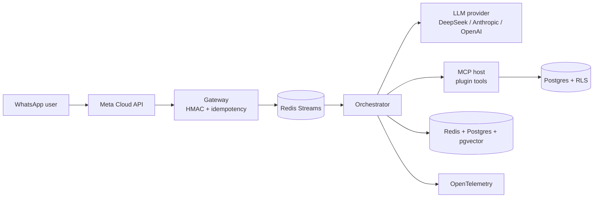

# agent-core

> **A multi-tenant runtime for production AI agents — one codebase, many clients.**

[](https://github.com/devrochy/agent-core/actions/workflows/ci.yml)
[](LICENSE)
[](pyproject.toml)

**TL;DR** — One deployment serves many clients. Each tenant gets its own
AgentSpec, tools, channels and memory, isolated by `tenant_id` + Postgres RLS.
Plugins run in-process; no forks, no per-client code, no prompts in code.

| | |
|---|---|
| **Problem** | Teams copy/paste an agent per client and lose control of prompts, data isolation and costs. |
| **What I built** | A modular monolith with pooled multi-tenancy, RLS, versioned AgentSpecs, in-process plugin tools and an append-only usage ledger. |
| **Proof** | 1,175 commits · 390+ test files · 20+ ADRs · CI with unit, integration, RLS isolation, Gitleaks, import-linter and evals. |

## What it includes

| Capability | Implementation |
|---|---|
| Multi-tenancy | `tenant_id` + RLS on every business table; capabilities enabled per pack |
| AgentSpec | Per-tenant assistant personality in the database; playbooks with allowlists |
| LLM agnostic | DeepSeek (default) · Anthropic · OpenAI · any OpenAI-compatible API |
| Memory | 3 layers: Redis (working) · PostgreSQL (entity) · pgvector (semantic/RAG) |
| Plugins | Python packages discovered via `entry_points`, full lifecycle, auto-disable on error |
| Tool protocol | MCP-style host: plugins expose tools once; the core translates to each LLM's function calling |
| Channels | WhatsApp (Meta Cloud API) included; per-provider adapters |
| Admin | SSR panel (Jinja2) with AgentSpec editor, tenant selector and onboarding wizard |
| Reliability | 3-layer idempotency · debounce · guardrails · kill switch · human escalation · canary/rollback |

## Architecture



## Why this exists

Most "multi-tenant AI agent" projects are a prompt with a `tenant_id` column.
This one treats tenancy as an architecture problem: every business table is
protected by RLS, every tenant has a versioned AgentSpec, and every tool call is
validated against a contract before it touches the database. The LLM proposes;
the platform decides.

## Key design decisions

| Decision | Choice | Why |
|---|---|---|
| Tenancy | Pooled multi-tenancy + Postgres RLS | One deployment, strong isolation, no per-client forks. |
| Architecture | Modular monolith | Less operational overhead than microservices at this stage. |
| Plugins | In-process Python packages | Zero network latency; a clear plugin contract. |
| Tool protocol | MCP-style host | Plugins expose tools once; the core translates to each LLM's function calling. |
| Memory | Redis + Postgres + pgvector | Working memory, entity memory and semantic retrieval. |
| Reliability | Idempotency, debounce, guardrails, kill switch, canary/rollback | The same discipline used in payments. |
| LLM | Provider-agnostic | DeepSeek by default for cost; Anthropic/OpenAI adapters available. |

Full rationale: [`docs/adr/`](docs/adr/).

## Quickstart

```bash
git clone https://github.com/devrochy/agent-core.git
cd agent-core
python3 -m venv .venv && source .venv/bin/activate
pip install -e .
agent-core init
docker compose up -d
# -> http://localhost:8000/admin
```

Create your first tenant:

```bash
agent-core tenant create
agent-core tenant seed <slug>
```

## Usage

```python
# A plugin exposes a tool through the MCP host.
from core.mcp import tool

@tool(name="consultar_inventario")
async def consultar_inventario(sku: str) -> dict:
    ...
```

## Testing and CI

```bash
pytest                 # unit + integration
pytest -m aislamiento  # RLS / cross-tenant isolation
```

CI runs lint, type checks, import-linter, unit tests, integration tests against
Postgres 17 + pgvector + PostGIS, Gitleaks over history, and evals in replay
mode. Evals against the real LLM run on demand, not on every PR.

## Observability and operations

- Structured logs with `structlog`.
- OpenTelemetry traces exported over OTLP.
- Sentry integration.
- Append-only usage ledger for per-tenant LLM cost.
- Kill switch, canary releases and rollback per agent version.

## Security

- RLS enforced with a non-owner `app_runtime` role; migrations run as owner.
- HMAC-SHA256 verification for WhatsApp webhooks.
- Secrets encrypted at rest; Gitleaks in CI.
- Tenant data lives under `TENANTS_ROOT/<slug>/` and is gitignored.

## Trade-offs

- **Modular monolith over microservices:** simpler to operate; extraction is
  possible later if a domain needs independent scaling.
- **In-process plugins over network services:** lower latency, but a bad plugin
  can affect the process; hence the guardrails and auto-disable.
- **Self-hosted Postgres over managed services:** more control over RLS and
  extensions, more operational responsibility.
- **DeepSeek as default:** cost control for high-volume conversations; the
  adapter keeps Anthropic/OpenAI available.

## Documentation

Detailed guides (in Spanish): [`docs/MULTITENANT.md`](docs/MULTITENANT.md),
[`docs/INSTALLATION.md`](docs/INSTALLATION.md),
[`docs/PLUGIN-CONTRACT.md`](docs/PLUGIN-CONTRACT.md),
[`docs/ARCHITECTURE.md`](docs/ARCHITECTURE.md) and
[`docs/ROADMAP.md`](docs/ROADMAP.md).

## License

MIT. See [LICENSE](LICENSE).

## Contact

[LinkedIn](https://linkedin.com/in/robinson-aguilar-ramirez-8970a1129) · [Email](mailto:devrochy@gmail.com)
