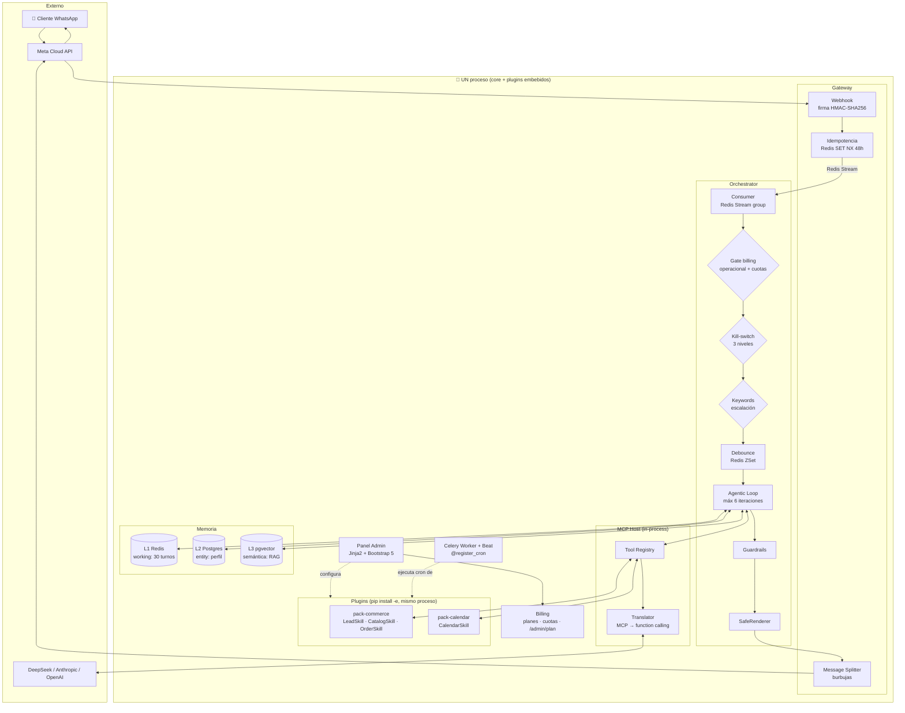

# Arquitectura de agent-core

> **SUPERSEDIDO por ADR-0001** (multi-tenant pooled + RLS). Describe la arquitectura
> single-tenant heredada del monolito. El patrón de monolito modular con plugins embebidos y
> los adaptadores selectivos (LLM/canal/cola) siguen vigentes; lo que cambia es el
> aislamiento de datos: `tenant_id` + RLS en toda tabla y un binario único para todos los
> clientes. Ver `docs/adr/0001-multitenant-pooled-rls.md` y `docs/ROADMAP.md`.

## Patrón: Monolito Modular con Adaptadores Selectivos

**No es arquitectura hexagonal.** Es la evolución pragmática validada en producción por
`agent-sale` (23 fases, 56 migraciones): capas simples + el patrón Adapter aplicado
SOLO en los tres puntos de variabilidad real (LLM, canal, cola). Ver ADR-001.

Las tres reglas:

1. **El core es plomería, los plugins son lógica de negocio.** El core enruta mensajes,
   llama al LLM, ejecuta tools y arbitra. No sabe qué es un "lead" o una "cita".
2. **Adapter Pattern solo donde se swappea de verdad**: `BaseLLMProvider` (DeepSeek ↔
   Anthropic ↔ OpenAI), `InboundAdapter`/`OutboundAdapter` (WhatsApp ↔ Telegram futuro),
   `TaskQueue` (Celery ↔ Arq futuro). El resto usa clases concretas.
3. **Los plugins hablan con el core SOLO a través del MCPHost** (registro de skills,
   guardrails, eventos, escalamiento). Nunca importan del orchestrator.

## Diagrama de flujo completo



## El turno de conversación, paso a paso

```
1. Meta envía webhook → verificación HMAC (app_secret de la conexión que matchea
   el phone_number_id del payload; fallback: conexión primaria → .env) → dedup
   (Redis NX) → XADD al stream → 200 OK
   (el LLM NUNCA corre dentro del request del webhook)

2. Consumer lee el stream:
   a. Resuelve/crea customer (UNIQUE canal+external_id) y conversation
   b. Kill-switch: global > cliente > conversación → si pausado: guarda y calla
   c. Persiste el inbound (idempotency_key UNIQUE = Capa 3)
   d. Keywords de escalación → escalate() + respuesta fija (determinístico, sin LLM)
   e. Debounce: inmediato → procesar ya | natural → timer en Redis ZSet
      (mensajes seguidos reinician el timer: ZADD actualiza el score)

3. Agentic Loop (core/orchestrator/loop.py):
   a. Memoria: L1 historial + L2 perfil + L3 recall semántico
   b. SkillRouter: solo las skills relevantes al turno entran al prompt
   c. SystemPromptBuilder: [base, tono, voz de marca, contexto dinámico]
   d. DifficultyRouter: deepseek-flash thinking off (default) | thinking on (complejo sin tools)
   e. LLM → tool_use? → MCPHost.execute_tool() [llamada Python in-process]
      → PluginError? → auto-disable del plugin, el turno continúa
      → resultado al historial → repetir (máx 6)
   f. end_turn → Guardrails (los plugins registran los suyos)
      → falla? 1 reintento correctivo → reincide? escalate()
   g. SafeExtras: _safe_append/_image_url de las tools se adjuntan DETERMINÍSTICAMENTE

4. Sender: split en burbujas (700ms entre cada una) → Meta Graph API → persistir outbound
```

## Puertos y adaptadores (los 3 selectivos)

| Puerto | Adaptadores incluidos | Futuro |
|---|---|---|
| `BaseLLMProvider` | `OpenAICompatibleProvider` (DeepSeek/OpenAI/xAI), `AnthropicProvider` | Gemini, Llama local |
| `InboundAdapter`/`OutboundAdapter` | `WhatsAppMeta*` | Telegram, Instagram, web chat |
| `TaskQueue` | `CeleryTaskQueue` | Arq, RQ |

Cambiar de proveedor LLM = `LLM_PROVIDER` en `.env` o BYOK en el panel. Cero código.

## Conexiones de canal (panel admin)

Las credenciales de cada canal viven en la tabla `channel_connections` (cifradas con
Fernet) y se gestionan en **`/admin/conexiones`**:

- El guardado valida las credenciales contra la Graph API de Meta **antes** de persistir
  (una credencial mala nunca se guarda: el síntoma de un canal roto no debería aparecer
  hasta el primer mensaje que no llega).
- Campos típicos de una conexión Meta/WhatsApp: `label`, `phone_number_id` (clave de
  ruteo), `app_secret` (firma HMAC), `access_token` y `verify_token` (handshake).
- Resolución en runtime (`core/gateway/connections.py`):
  conexión que matchea el `phone_number_id` del payload → conexión primaria activa → `.env`.

El webhook (`core/gateway/webhooks.py`) y el sender (`core/gateway/sender.py`) resuelven
las credenciales por este orden, de modo que mover credenciales del `.env` al panel es
opcional y no rompe nada mientras tanto.

## Memoria en 3 capas

| Capa | Storage | Contenido | Fallo |
|---|---|---|---|
| L1 Working | Redis (LIST, TTL 24h) | Últimos 30 turnos | Degrada a Postgres |
| L2 Entity | Postgres `customers.attributes` JSONB | Perfil durable (nombre, email, IDs externos) | No degrada (fuente de verdad) |
| L3 Semantic | Postgres + pgvector | Embeddings de hechos pasados (RAG) | Degrada a "sin recall" |

Los plugins escriben L2 con `entity_memory.upsert_attributes()`. El core escribe L3
después de cada turno y hace recall antes de cada turno.

## Robustez (heredada de agent-sale, probada en producción)

| Mecanismo | Implementación |
|---|---|
| Idempotencia 3 capas | Redis NX 48h → Stream re-delivery máx 3 + DLQ → UNIQUE Postgres |
| Kill-switch 3 niveles | `app_settings.bot_paused` → `customers.bot_paused` → `conversations.bot_paused` |
| Aislamiento de plugins | PluginError → auto-disable + aviso en panel; el asistente sigue |
| Crash recovery | Al arrancar: conversaciones con inbound pendiente sin timer → reprogramadas |
| Escalamiento | Nativo del core; SIEMPRE pausa el bot de esa conversación |
| Auditoría | `audit_log` inmutable por trigger: lo que la tool HIZO, no lo que el LLM propuso |
| Costos | `llm_usage` por llamada: tokens, latencia, USD; visible en /admin/costos |
