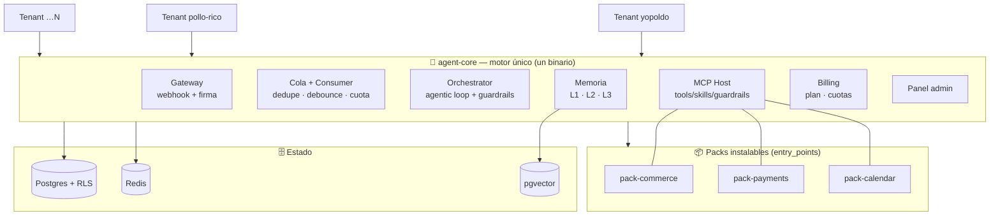
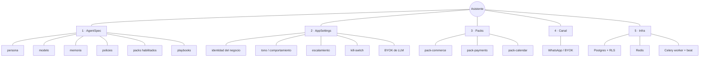
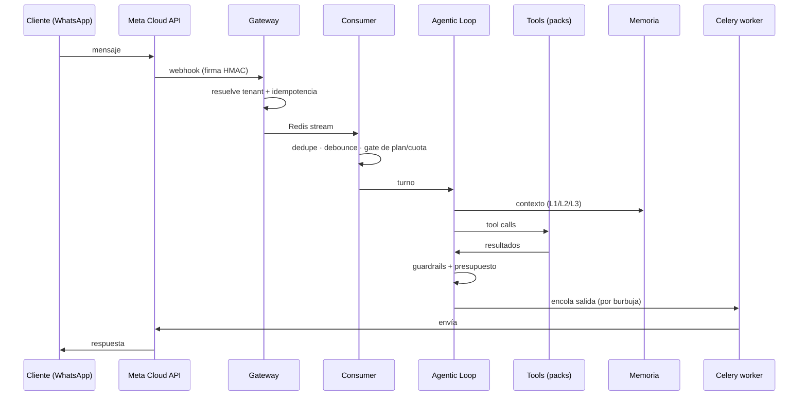
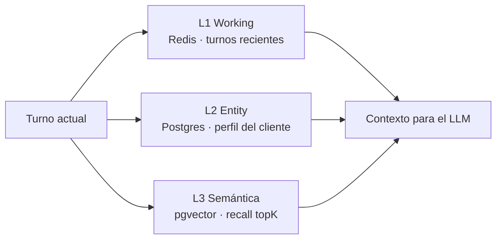
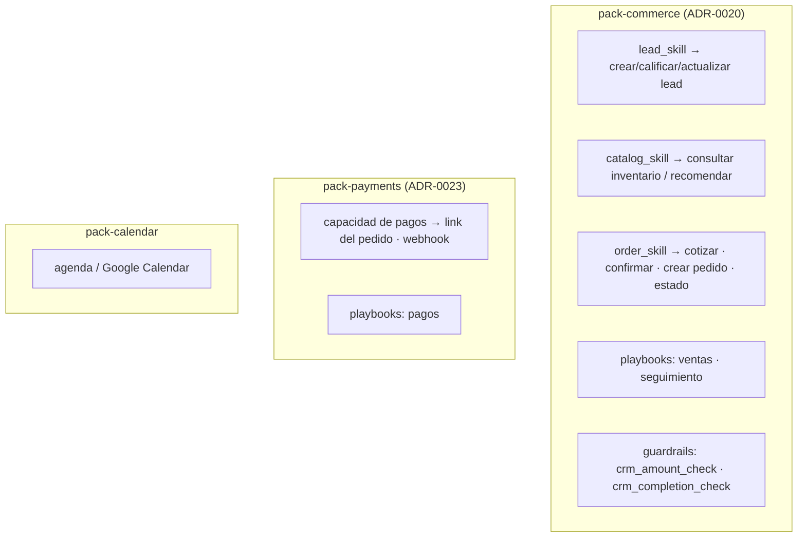
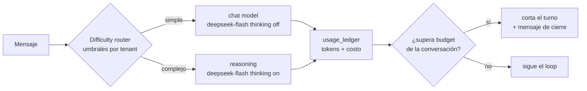

# El "sistema operativo" de asistentes (agent-core)

Cómo se ensambla y configura un asistente. Caso real: **`yopoldo`** (test) — restaurante de
pollo asado y frito en Manizales.

> Un asistente **no es código por cliente**. Es la combinación de: **motor único** (`core/`)
> + **packs instalables** (`packages/pack-*`) + **configuración por tenant** (AgentSpec,
> AppSettings) + **canal**. Un solo binario sirve a todos los tenants, aislados por
> `tenant_id` + RLS (ADR-0001).

Referencias: `MULTITENANT.md`, `INSTALLATION.md`, `FIRST-ASSISTANT.md`, `PLUGIN-CONTRACT.md`,
`BILLING.md`, ADR-0001/0014/0045/0050.

---

## 1. Vista general: el SO y sus tenants



**Regla de oro:** personalizar = ordenar en esta lista, nunca forkear:
**configuración → pack → plugin del tenant → topología de despliegue.**

---

## 2. Los 5 ejes de configuración de un asistente



---

## 3. El turno, paso a paso (de mensaje a respuesta)



> **Sin `celery-worker` no salen mensajes** (quedan `queued`). El `beat` dispara los crons
> de los packs (seguimientos, etc.).

---

## 4. Componentes y su ubicación

| Pieza | Dónde vive | Provee | ¿Por tenant? |
|---|---|---|---|
| Motor (gateway, orchestrator, loop, MCP, memoria, billing, panel) | `core/` | el SO | global |
| Contratos congelados (AgentSpec, …) | `packages/contracts` | el "kernel" tipado | global |
| Packs verticales | `packages/pack-*` | lógica de negocio | se habilitan por tenant |
| Identidad y reglas | `agent_specs` (BD, versionado) | configuración | sí |
| Identidad del negocio / tono / kill-switch / BYOK | `app_settings` | configuración | sí |
| Canal (WhatsApp) | `meta_connections` / `channel_connections` | credenciales cifradas | sí |
| Plan y cuotas | `tenant_subscriptions` | billing de plataforma | sí |
| Perfil de cliente | `customers` | memoria L2 | sí |
| Vectorial | `memory_vectors` (pgvector) | memoria L3 | sí |
| Costo por turno | `usage_ledger` (append-only) | facturación/observabilidad | sí |

---

## 5. Memoria en 3 capas



- **L1 Working** (Redis): últimos turnos de la conversación (`shortTermTurns`), efímera.
- **L2 Entity** (Postgres): perfil estructurado del cliente; tools `get_customer_profile`,
  `update_customer_profile`, `remember_fact`.
- **L3 RAG** (pgvector): `recall(query, topK, minScore)` con redacción de PII y purga.

---

## 6. Packs: qué aporta cada uno



Cada pack trae sus propias tablas (prefijo `pack_<nombre>_`), migraciones Alembic
independientes y su config por tenant.

### Flujo de atención (ADR-0054, ADR-0109)

El flujo agrupa las tools por **etapas** de la atención y se **compone** en cada turno:

- `core/flow.json`: `core:saludo` y `core:escalamiento`, una sola vez para todo negocio;
- `packages/pack-*/flow.json`: las secciones de **todos** los packs habilitados (`pack_x:id`), siempre al día;
- `TENANTS_ROOT/<slug>/flow.json`: solo las secciones propias del negocio (`tenant`) y overrides explícitos.
  Ya no es autoritativo ni se siembra con copias de los packs.

- Se inyecta como bloque estable del system prompt (`## Flujo de atención`) y define el conjunto de tools
  del turno; las tools del core (`always_available`: memoria, perfil, escalamiento, correo, `sub_*`) se
  ofrecen aunque el flujo no las nombre. Sin flujo, se cae al `SkillRouter` por keywords.
- Las secciones **no** restringen en runtime qué tool puede llamarse: la compuerta de ejecución sigue
  siendo `AgentSpec.tools` + packs (`_tool_denial`).
- Operación: `agent-core flow show|validate|sync|migrate <slug>`; el panel solo lo muestra en lectura.

### Presets de negocio (ADR-0110)

Un **preset** arma un tipo de negocio (comercio, restaurante, cobranza…) en una llamada:
`core/presets/<id>.json` es un manifiesto corto (packs, playbooks por nombre, persona, `AppSettings`,
plan mínimo, conexiones y pasos de activación) y cada pack aporta su fragmento por vertical en
`packages/pack-*/presets/<vertical>.json` (config sin secretos y datos de ejemplo para `seed_data`).
`apply_preset` es idempotente: valida el plan, habilita los packs (los que exigen claves quedan
**pendientes de configurar** sin romper el alta), completa la config sin pisar lo del negocio, siembra,
registra `tenants.settings["preset"]` y el `audit_log`. Es **configuración**: no agrega código ni reemplaza
a un pack o a un plugin del tenant.

---

## 7. Configuración actual de `yopoldo`

```mermaid
graph TB
  Y[yopoldo · test]
  Y --> S[AgentSpec activo]
  Y --> A[AppSettings]
  Y --> P[Packs habilitados]
  Y --> B[Plan]

  S --> S1["persona: asistente · tono cercano · emojis sparse · máx 500"]
  S --> S2["model: deepseek-flash · temperature 0.3"]
  S --> S3["memory: shortTermTurns 30 (+ rag/summarize en BD)"]
  S --> S4["policies: maxToolCallsPerTurn 10 · budget 0.5 USD"]
  S --> S5["packs: [pack_commerce]"]
  S --> S6["playbooks: identidad·tono·reglas-operacion·respuestas·seguimiento·ventas·pagos"]

  A --> A1["nombre: Yopoldo · idioma es · bot_paused: false"]
  A --> A2["descripción: pollo asado/frito manizaleño"]
  A --> A3["escalamiento: asesor·humano·persona real·reclamo·queja"]
  A --> A4["LLM: sin BYOK → usa .env del despliegue"]

  P --> P1["pack_commerce (config cifrada)"]
  P --> P2["pack_payments (config cifrada)"]

  B --> B1["plan free · status trialing"]
```



**Uso real en test:** 11 conversaciones · 11 clientes · 127 mensajes.

> **Nota de consistencia:** `pack_payments` está habilitado en `plugin_configs` y `pagos`
> figura en los playbooks, pero el `spec.packs` activo solo lista `pack_commerce`. A revisar
> (no se corrigió en este documento).

---

## 8. Modelo (LLM) y presupuesto



- **DeepSeek por defecto** (`.env`); **BYOK por tenant** opcional (llave cifrada AES-GCM).
- **Presupuesto** (`budgetUsdPerConversation`) medido contra `usage_ledger` antes de cada
  llamada; al agotar, se corta el turno (ADR-0015).
- Costo por conversación visible en el panel (`/admin/costos`).

---

## 9. Qué necesita un asistente para trabajar (checklist)

```mermaid
flowchart TD
  T[1. Tenant creado] --> SP[2. Packs en spec.packs]
  SP --> PB[3. Playbooks presentes]
  PB --> LLM[4. Llave LLM o BYOK]
  LLM --> CH[5. Canal conectado + webhook]
  CH --> SV[6. core-api + worker + beat]
  SV --> INF[7. Postgres + Redis (+pgvector)]
  INF --> SEED[8. Catálogo seed si es commerce]
  SEED --> OK((Asistente operando))
```

1. **Tenant** creado (`onboard_tenant` → AgentSpec + AppSettings + plan `free`).
2. **Packs** habilitados en `spec.packs`.
3. **Playbooks** referenciados presentes (core/pack o override del tenant, ADR-0026).
4. **LLM**: llave del despliegue o BYOK del tenant.
5. **Canal**: `MetaConnection`/`ChannelConnection` con credenciales + webhook suscrito.
6. **Servicios**: `core-api` + `celery-worker` + `celery-beat`.
7. **Infra**: Postgres+RLS, Redis; pgvector opcional (RAG).
8. **Catálogo** (`tenant seed`) solo si el pack es de comercio.

---

## 10. Invariantes que sostienen el modelo

| Invariante | Efecto |
|---|---|
| Multi-tenant + RLS (ADR-0001) | un binario sirve a todos; aislamiento en BD |
| Cero prompts en código (ADR-0014) | identidad/reglas viven en playbooks versionados |
| Tablas de pack con prefijo (ADR-0004) | los verticales no chocan entre sí |
| Tools in-process / terceros MCP (ADR-0005) | el pack expone capacidades sin acoplar al core |
| `usage_ledger` append-only (ADR-0008) | costo auditable → base de facturación |
| Contratos congelados (ADR-0011) | el "kernel" no cambia sin ADR |
| Planes y cuotas (ADR-0045/0046) | el SO vende y limita por tenant |

---

## Apéndice — De dónde salió cada dato

- `yopoldo` leído de la BD de test `agent_core` (tenant `a12fea12-…`, spec activo,
  `app_settings`, `plugin_configs`, `tenant_subscriptions`, conteos de uso).
- Playbooks del core en `core/playbooks/`; de packs en `packages/pack-*/playbooks/`.
- Tools y config en `core/tools/core_skill.py`, `packages/pack-*/pack_*/{skills,config}.py`.
- Sin secretos transcritos: solo estructura y valores no sensibles.
