# Diagramas C4 de solvershub

La fuente es [`workspace.dsl`](workspace.dsl) (ADR-0189). **Los bloques Mermaid de este archivo
se generan: no se editan a mano.** Para cambiar un diagrama se edita el modelo y se regenera:

```bash
docker run -d --name structurizr-mcp -p 127.0.0.1:3333:3000 -e PORT=3000 structurizr/mcp:2026.04.20 -dsl -mermaid -plantuml
```

```bash
python scripts/export_c4.py
```

Para ver el modelo de forma interactiva, usar la imagen `structurizr/structurizr` con el
comando `local`, sobre una copia del directorio porque escribe archivos propios en él.

Modelo leído de `develop` el 2026-11-08. El estado de cada elemento (solo en test, sin activar,
en retiro u objetivo) está en su descripción y en sus etiquetas dentro del modelo.

## Nivel 1: contexto

Quién usa solvershub y con qué sistemas se integra.

<!-- c4:contexto -->
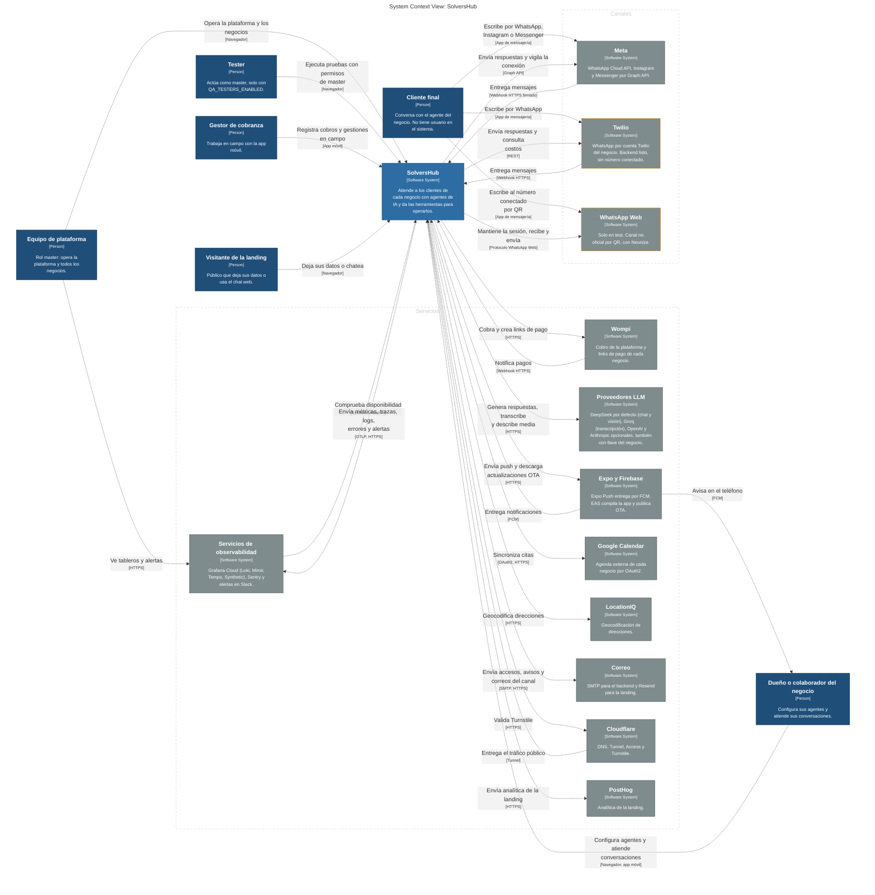
<!-- /c4:contexto -->

## Nivel 2: contenedores

`core-api`, `celery-worker`, `celery-beat` y `waweb-connector` son la misma imagen con distinto
`AGENT_CORE_ROLE`. `core-api` recibe y decide; `celery-worker` es quien envía los mensajes.

<!-- c4:contenedores -->
```mermaid
graph LR

  subgraph diagram ["Container View: SolversHub"]
    direction LR
    style diagram fill:#ffffff,stroke:#ffffff

    1["<div style='font-weight: bold'>Equipo de plataforma</div><div style='font-size: 70%; margin-top: 0px'>[Person]</div><div style='font-size: 80%; margin-top:10px'>Rol master: opera la<br />plataforma y todos los<br />negocios.</div>"]
    style 1 fill:#1f4e79,stroke:#153654,color:#ffffff
    2["<div style='font-weight: bold'>Tester</div><div style='font-size: 70%; margin-top: 0px'>[Person]</div><div style='font-size: 80%; margin-top:10px'>Actúa como master, solo con<br />QA_TESTERS_ENABLED.</div>"]
    style 2 fill:#1f4e79,stroke:#153654,color:#ffffff
    3["<div style='font-weight: bold'>Dueño o colaborador del negocio</div><div style='font-size: 70%; margin-top: 0px'>[Person]</div><div style='font-size: 80%; margin-top:10px'>Configura sus agentes y<br />atiende sus conversaciones.</div>"]
    style 3 fill:#1f4e79,stroke:#153654,color:#ffffff
    4["<div style='font-weight: bold'>Gestor de cobranza</div><div style='font-size: 70%; margin-top: 0px'>[Person]</div><div style='font-size: 80%; margin-top:10px'>Trabaja en campo con la app<br />móvil.</div>"]
    style 4 fill:#1f4e79,stroke:#153654,color:#ffffff
    6["<div style='font-weight: bold'>Visitante de la landing</div><div style='font-size: 70%; margin-top: 0px'>[Person]</div><div style='font-size: 80%; margin-top:10px'>Público que deja sus datos o<br />usa el chat web.</div>"]
    style 6 fill:#1f4e79,stroke:#153654,color:#ffffff

    subgraph 20 ["SolversHub"]
      style 20 fill:#ffffff,stroke:#204c72,color:#204c72

      subgraph group1 ["Backend (una imagen, cuatro roles por AGENT_CORE_ROLE)"]
        style group1 fill:#ffffff,stroke:#cccccc,color:#cccccc,stroke-dasharray:5

        24["<div style='font-weight: bold'>core-api</div><div style='font-size: 70%; margin-top: 0px'>[Container: Python 3.12, FastAPI]</div><div style='font-size: 80%; margin-top:10px'>API /api/v1, webhooks y panel<br />clásico. En el mismo proceso<br />consume la cola y ejecuta los<br />turnos del agente.</div>"]
        style 24 fill:#3f8fd2,stroke:#2c6493,color:#ffffff
        50["<div style='font-weight: bold'>celery-worker</div><div style='font-size: 70%; margin-top: 0px'>[Container: Python, Celery]</div><div style='font-size: 80%; margin-top:10px'>Envía los mensajes salientes<br />y ejecuta push, crons y<br />evaluaciones.</div>"]
        style 50 fill:#3f8fd2,stroke:#2c6493,color:#ffffff
        59["<div style='font-weight: bold'>celery-beat</div><div style='font-size: 70%; margin-top: 0px'>[Container: Python, Celery Beat]</div><div style='font-size: 80%; margin-top:10px'>Programa los crons. Instancia<br />única.</div>"]
        style 59 fill:#3f8fd2,stroke:#2c6493,color:#ffffff
        60["<div style='font-weight: bold'>waweb-connector</div><div style='font-size: 70%; margin-top: 0px'>[Container: Python, Neonize]</div><div style='font-size: 80%; margin-top:10px'>Solo en test. Mantiene un<br />socket de WhatsApp Web por<br />tenant.</div>"]
        style 60 fill:#3f8fd2,stroke:#c77700,color:#ffffff
      end

      subgraph group2 ["Borde"]
        style group2 fill:#ffffff,stroke:#cccccc,color:#cccccc,stroke-dasharray:5

        64["<div style='font-weight: bold'>cloudflared</div><div style='font-size: 70%; margin-top: 0px'>[Container: Cloudflare Tunnel]</div><div style='font-size: 80%; margin-top:10px'>Conecta los hostnames<br />públicos con los servicios<br />internos, sin puertos<br />abiertos.</div>"]
        style 64 fill:#3f8fd2,stroke:#2c6493,color:#ffffff
      end

      subgraph group3 ["Clientes"]
        style group3 fill:#ffffff,stroke:#cccccc,color:#cccccc,stroke-dasharray:5

        21["<div style='font-weight: bold'>landing</div><div style='font-size: 70%; margin-top: 0px'>[Container: Next.js 16]</div><div style='font-size: 80%; margin-top:10px'>Sitio público, formularios de<br />leads y chat web.</div>"]
        style 21 fill:#3f8fd2,stroke:#2c6493,color:#ffffff
        22["<div style='font-weight: bold'>panel-web</div><div style='font-size: 70%; margin-top: 0px'>[Container: Next.js 16, React 19]</div><div style='font-size: 80%; margin-top:10px'>Panel de administración. Su<br />BFF /api/* guarda el token y<br />llama al backend.</div>"]
        style 22 fill:#3f8fd2,stroke:#2c6493,color:#ffffff
        23["<div style='font-weight: bold'>App móvil</div><div style='font-size: 70%; margin-top: 0px'>[Container: Expo, React Native, SQLCipher]</div><div style='font-size: 80%; margin-top:10px'>Cobranza en campo para<br />gestores y seguimiento del<br />negocio para dueños y<br />administradores, con datos<br />locales cifrados.</div>"]
        style 23 fill:#3f8fd2,stroke:#2c6493,color:#ffffff
      end

      subgraph group4 ["Datos"]
        style group4 fill:#ffffff,stroke:#cccccc,color:#cccccc,stroke-dasharray:5

        61[("<div style='font-weight: bold'>Postgres</div><div style='font-size: 70%; margin-top: 0px'>[Container: PostgreSQL 17, pgvector, PostGIS]</div><div style='font-size: 80%; margin-top:10px'>Datos de negocio aislados por<br />RLS y vectores.</div>")]
        style 61 fill:#3f8fd2,stroke:#2c6493,color:#ffffff
        62[("<div style='font-weight: bold'>Redis</div><div style='font-size: 70%; margin-top: 0px'>[Container: Redis 7]</div><div style='font-size: 80%; margin-top:10px'>Cola de entrada, debounce,<br />locks, memoria de trabajo y<br />broker de Celery.</div>")]
        style 62 fill:#3f8fd2,stroke:#2c6493,color:#ffffff
        63["<div style='font-weight: bold'>Volumen tenants</div><div style='font-size: 70%; margin-top: 0px'>[Container: Volumen Docker]</div><div style='font-size: 80%; margin-top:10px'>Artefactos por negocio:<br />media, documentos,<br />evidencias, flow.json y<br />overrides de playbooks.</div>"]
        style 63 fill:#3f8fd2,stroke:#2c6493,color:#ffffff
      end

    end

    1-. "<div>Administra negocios y<br />cobranza</div><div style='font-size: 70%'>[Android]</div>" .->23
    1-. "<div>Usa las secciones que quedan<br />del panel clásico</div><div style='font-size: 70%'>[HTTPS]</div>" .->24
    21-. "<div>Envía leads y reenvía el chat<br />web</div><div style='font-size: 70%'>[HTTP; X-Intake-Secret solo en leads]</div>" .->24
    22-. "<div>Llama a /api/v1 desde el BFF</div><div style='font-size: 70%'>[HTTP, Bearer, X-Tenant-Id]</div>" .->24
    23-. "<div>Usa la API de campo y /api/v1</div><div style='font-size: 70%'>[HTTPS, Bearer]</div>" .->24
    64-. "<div>Enruta webhooks, /healthz y<br />las rutas públicas de API</div><div style='font-size: 70%'>[HTTP]</div>" .->24
    64-. "<div>Enruta el resto de los<br />hostnames del panel</div><div style='font-size: 70%'>[HTTP]</div>" .->22
    24-. "<div>Encola envíos, push y<br />evaluaciones</div><div style='font-size: 70%'>[Celery sobre Redis]</div>" .->50
    59-. "<div>Dispara los crons</div><div style='font-size: 70%'>[Celery sobre Redis]</div>" .->50
    50-. "<div>Pide envíos por WhatsApp Web</div><div style='font-size: 70%'>[Redis: waweb:outbox, waweb:reply]</div>" .->60
    60-. "<div>Publica mensajes entrantes,<br />QR y estado</div><div style='font-size: 70%'>[Redis Streams y claves waweb:*]</div>" .->24
    24-. "<div>Pide reiniciar la sesión</div><div style='font-size: 70%'>[Redis: waweb:reset]</div>" .->60
    24-. "<div>Lee y escribe con<br />tenant_scope</div><div style='font-size: 70%'>[SQLAlchemy async, rol app_runtime]</div>" .->61
    50-. "<div>Lee y escribe con<br />tenant_scope</div><div style='font-size: 70%'>[SQLAlchemy async, rol app_runtime]</div>" .->61
    59-. "<div>Lee horarios de<br />cron_job_configs</div><div style='font-size: 70%'>[SQLAlchemy]</div>" .->61
    60-. "<div>Guarda credenciales de sesión<br />cifradas</div><div style='font-size: 70%'>[SQLAlchemy]</div>" .->61
    24-. "<div>Cola de entrada, debounce,<br />memoria de trabajo, caché de<br />equipos y límites</div><div style='font-size: 70%'>[Redis]</div>" .->62
    50-. "<div>Broker, locks de cron y<br />latido</div><div style='font-size: 70%'>[Redis]</div>" .->62
    59-. "<div>Publica tareas programadas</div><div style='font-size: 70%'>[Redis]</div>" .->62
    60-. "<div>Colas de envío, QR y frenos<br />antibaneo</div><div style='font-size: 70%'>[Redis]</div>" .->62
    24-. "<div>Escribe media y documentos,<br />lee flow.json y overrides</div><div style='font-size: 70%'>[Sistema de archivos]</div>" .->63
    50-. "<div>Lee documentos y artefactos</div><div style='font-size: 70%'>[Sistema de archivos]</div>" .->63
    6-. "<div>Llena formularios y usa el<br />chat web</div><div style='font-size: 70%'>[HTTPS]</div>" .->21
    1-. "<div>Administra la plataforma</div><div style='font-size: 70%'>[HTTPS]</div>" .->22
    2-. "<div>Ejecuta el catálogo de<br />pruebas</div><div style='font-size: 70%'>[HTTPS]</div>" .->22
    3-. "<div>Administra su negocio</div><div style='font-size: 70%'>[HTTPS]</div>" .->22
    4-. "<div>Registra cobros y gestiones</div><div style='font-size: 70%'>[Android]</div>" .->23
    3-. "<div>Consulta el negocio y recibe<br />avisos</div><div style='font-size: 70%'>[Android]</div>" .->23

  end
```
<!-- /c4:contenedores -->

### Integraciones externas

<!-- c4:contenedores-integraciones -->
```mermaid
graph LR

  subgraph diagram ["Container View: SolversHub"]
    direction LR
    style diagram fill:#ffffff,stroke:#ffffff

    7["<div style='font-weight: bold'>Meta</div><div style='font-size: 70%; margin-top: 0px'>[Software System]</div><div style='font-size: 80%; margin-top:10px'>WhatsApp Cloud API, Instagram<br />y Messenger por Graph API.</div>"]
    style 7 fill:#7f8c8d,stroke:#586262,color:#ffffff
    8["<div style='font-weight: bold'>Twilio</div><div style='font-size: 70%; margin-top: 0px'>[Software System]</div><div style='font-size: 80%; margin-top:10px'>WhatsApp por cuenta Twilio<br />del negocio. Backend listo,<br />sin número conectado.</div>"]
    style 8 fill:#7f8c8d,stroke:#c77700,color:#ffffff
    9["<div style='font-weight: bold'>WhatsApp Web</div><div style='font-size: 70%; margin-top: 0px'>[Software System]</div><div style='font-size: 80%; margin-top:10px'>Solo en test. Canal no<br />oficial por QR, con Neonize.</div>"]
    style 9 fill:#7f8c8d,stroke:#c77700,color:#ffffff
    10["<div style='font-weight: bold'>Wompi</div><div style='font-size: 70%; margin-top: 0px'>[Software System]</div><div style='font-size: 80%; margin-top:10px'>Cobro de la plataforma y<br />links de pago de cada<br />negocio.</div>"]
    style 10 fill:#7f8c8d,stroke:#586262,color:#ffffff
    11["<div style='font-weight: bold'>Proveedores LLM</div><div style='font-size: 70%; margin-top: 0px'>[Software System]</div><div style='font-size: 80%; margin-top:10px'>DeepSeek por defecto (chat y<br />visión), Groq<br />(transcripción), OpenAI y<br />Anthropic opcionales, también<br />con llave del negocio.</div>"]
    style 11 fill:#7f8c8d,stroke:#586262,color:#ffffff
    12["<div style='font-weight: bold'>Expo y Firebase</div><div style='font-size: 70%; margin-top: 0px'>[Software System]</div><div style='font-size: 80%; margin-top:10px'>Expo Push entrega por FCM.<br />EAS compila la app y publica<br />OTA.</div>"]
    style 12 fill:#7f8c8d,stroke:#586262,color:#ffffff
    13["<div style='font-weight: bold'>Google Calendar</div><div style='font-size: 70%; margin-top: 0px'>[Software System]</div><div style='font-size: 80%; margin-top:10px'>Agenda externa de cada<br />negocio por OAuth2.</div>"]
    style 13 fill:#7f8c8d,stroke:#586262,color:#ffffff
    14["<div style='font-weight: bold'>LocationIQ</div><div style='font-size: 70%; margin-top: 0px'>[Software System]</div><div style='font-size: 80%; margin-top:10px'>Geocodificación de<br />direcciones.</div>"]
    style 14 fill:#7f8c8d,stroke:#586262,color:#ffffff
    15["<div style='font-weight: bold'>Correo</div><div style='font-size: 70%; margin-top: 0px'>[Software System]</div><div style='font-size: 80%; margin-top:10px'>SMTP para el backend y Resend<br />para la landing.</div>"]
    style 15 fill:#7f8c8d,stroke:#586262,color:#ffffff
    16["<div style='font-weight: bold'>Cloudflare</div><div style='font-size: 70%; margin-top: 0px'>[Software System]</div><div style='font-size: 80%; margin-top:10px'>DNS, Tunnel, Access y<br />Turnstile.</div>"]
    style 16 fill:#7f8c8d,stroke:#586262,color:#ffffff
    17["<div style='font-weight: bold'>PostHog</div><div style='font-size: 70%; margin-top: 0px'>[Software System]</div><div style='font-size: 80%; margin-top:10px'>Analítica de la landing.</div>"]
    style 17 fill:#7f8c8d,stroke:#586262,color:#ffffff

    subgraph 20 ["SolversHub"]
      style 20 fill:#ffffff,stroke:#204c72,color:#204c72

      subgraph group1 ["Backend (una imagen, cuatro roles por AGENT_CORE_ROLE)"]
        style group1 fill:#ffffff,stroke:#cccccc,color:#cccccc,stroke-dasharray:5

        24["<div style='font-weight: bold'>core-api</div><div style='font-size: 70%; margin-top: 0px'>[Container: Python 3.12, FastAPI]</div><div style='font-size: 80%; margin-top:10px'>API /api/v1, webhooks y panel<br />clásico. En el mismo proceso<br />consume la cola y ejecuta los<br />turnos del agente.</div>"]
        style 24 fill:#3f8fd2,stroke:#2c6493,color:#ffffff
        50["<div style='font-weight: bold'>celery-worker</div><div style='font-size: 70%; margin-top: 0px'>[Container: Python, Celery]</div><div style='font-size: 80%; margin-top:10px'>Envía los mensajes salientes<br />y ejecuta push, crons y<br />evaluaciones.</div>"]
        style 50 fill:#3f8fd2,stroke:#2c6493,color:#ffffff
        60["<div style='font-weight: bold'>waweb-connector</div><div style='font-size: 70%; margin-top: 0px'>[Container: Python, Neonize]</div><div style='font-size: 80%; margin-top:10px'>Solo en test. Mantiene un<br />socket de WhatsApp Web por<br />tenant.</div>"]
        style 60 fill:#3f8fd2,stroke:#c77700,color:#ffffff
      end

      subgraph group2 ["Borde"]
        style group2 fill:#ffffff,stroke:#cccccc,color:#cccccc,stroke-dasharray:5

        64["<div style='font-weight: bold'>cloudflared</div><div style='font-size: 70%; margin-top: 0px'>[Container: Cloudflare Tunnel]</div><div style='font-size: 80%; margin-top:10px'>Conecta los hostnames<br />públicos con los servicios<br />internos, sin puertos<br />abiertos.</div>"]
        style 64 fill:#3f8fd2,stroke:#2c6493,color:#ffffff
      end

      subgraph group3 ["Clientes"]
        style group3 fill:#ffffff,stroke:#cccccc,color:#cccccc,stroke-dasharray:5

        21["<div style='font-weight: bold'>landing</div><div style='font-size: 70%; margin-top: 0px'>[Container: Next.js 16]</div><div style='font-size: 80%; margin-top:10px'>Sitio público, formularios de<br />leads y chat web.</div>"]
        style 21 fill:#3f8fd2,stroke:#2c6493,color:#ffffff
        23["<div style='font-weight: bold'>App móvil</div><div style='font-size: 70%; margin-top: 0px'>[Container: Expo, React Native, SQLCipher]</div><div style='font-size: 80%; margin-top:10px'>Cobranza en campo para<br />gestores y seguimiento del<br />negocio para dueños y<br />administradores, con datos<br />locales cifrados.</div>"]
        style 23 fill:#3f8fd2,stroke:#2c6493,color:#ffffff
      end

    end

    21-. "<div>Envía leads y reenvía el chat<br />web</div><div style='font-size: 70%'>[HTTP; X-Intake-Secret solo en leads]</div>" .->24
    21-. "<div>Notifica leads si no hay<br />webhook configurado</div><div style='font-size: 70%'>[Resend, HTTPS]</div>" .->15
    21-. "<div>Muestra el widget Turnstile<br />en el navegador</div><div style='font-size: 70%'>[HTTPS]</div>" .->16
    21-. "<div>Envía eventos desde el<br />navegador</div><div style='font-size: 70%'>[HTTPS]</div>" .->17
    23-. "<div>Usa la API de campo y /api/v1</div><div style='font-size: 70%'>[HTTPS, Bearer]</div>" .->24
    23-. "<div>Registra el token y descarga<br />OTA</div><div style='font-size: 70%'>[HTTPS]</div>" .->12
    12-. "<div>Entrega notificaciones</div><div style='font-size: 70%'>[FCM]</div>" .->23
    16-. "<div>Entrega el tráfico de los<br />hostnames públicos</div><div style='font-size: 70%'>[Tunnel]</div>" .->64
    64-. "<div>Enruta webhooks, /healthz y<br />las rutas públicas de API</div><div style='font-size: 70%'>[HTTP]</div>" .->24
    7-. "<div>Entrega mensajes</div><div style='font-size: 70%'>[Webhook HTTPS firmado]</div>" .->24
    8-. "<div>Entrega mensajes</div><div style='font-size: 70%'>[Webhook HTTPS]</div>" .->24
    10-. "<div>Notifica pagos</div><div style='font-size: 70%'>[Webhook HTTPS]</div>" .->24
    24-. "<div>Encola envíos, push y<br />evaluaciones</div><div style='font-size: 70%'>[Celery sobre Redis]</div>" .->50
    50-. "<div>Pide envíos por WhatsApp Web</div><div style='font-size: 70%'>[Redis: waweb:outbox, waweb:reply]</div>" .->60
    60-. "<div>Publica mensajes entrantes,<br />QR y estado</div><div style='font-size: 70%'>[Redis Streams y claves waweb:*]</div>" .->24
    24-. "<div>Pide reiniciar la sesión</div><div style='font-size: 70%'>[Redis: waweb:reset]</div>" .->60
    60-. "<div>Mantiene un socket por tenant</div><div style='font-size: 70%'>[Protocolo WhatsApp Web]</div>" .->9
    24-. "<div>Descarga media y administra<br />conexiones</div><div style='font-size: 70%'>[Graph API]</div>" .->7
    24-. "<div>Descarga media y administra<br />conexiones</div><div style='font-size: 70%'>[REST]</div>" .->8
    50-. "<div>Envía mensajes y vigila la<br />conexión</div><div style='font-size: 70%'>[Graph API]</div>" .->7
    50-. "<div>Envía mensajes y consulta<br />costos</div><div style='font-size: 70%'>[REST]</div>" .->8
    24-. "<div>Cobra y crea links de pago</div><div style='font-size: 70%'>[HTTPS]</div>" .->10
    50-. "<div>Crea links de cobro de<br />suscripciones</div><div style='font-size: 70%'>[HTTPS]</div>" .->10
    24-. "<div>Genera respuestas,<br />transcribe, describe y crea<br />embeddings</div><div style='font-size: 70%'>[HTTPS]</div>" .->11
    50-. "<div>Corre evaluaciones y<br />embeddings de documentos</div><div style='font-size: 70%'>[HTTPS]</div>" .->11
    24-. "<div>Sincroniza citas</div><div style='font-size: 70%'>[OAuth2, HTTPS]</div>" .->13
    24-. "<div>Geocodifica direcciones</div><div style='font-size: 70%'>[HTTPS]</div>" .->14
    24-. "<div>Envía correos de acceso</div><div style='font-size: 70%'>[SMTP]</div>" .->15
    50-. "<div>Envía correos del canal, de<br />facturación y de acceso</div><div style='font-size: 70%'>[SMTP]</div>" .->15
    24-. "<div>Valida Turnstile</div><div style='font-size: 70%'>[HTTPS]</div>" .->16
    50-. "<div>Envía notificaciones push</div><div style='font-size: 70%'>[HTTPS]</div>" .->12

  end
```
<!-- /c4:contenedores-integraciones -->

### Telemetría (ADR-0188)

Hoy recoge test: activar producción sigue pendiente.

<!-- c4:telemetria -->
```mermaid
graph LR

  subgraph diagram ["Container View: SolversHub"]
    direction LR
    style diagram fill:#ffffff,stroke:#ffffff

    1["<div style='font-weight: bold'>Equipo de plataforma</div><div style='font-size: 70%; margin-top: 0px'>[Person]</div><div style='font-size: 80%; margin-top:10px'>Rol master: opera la<br />plataforma y todos los<br />negocios.</div>"]
    style 1 fill:#1f4e79,stroke:#153654,color:#ffffff
    18["<div style='font-weight: bold'>Servicios de observabilidad</div><div style='font-size: 70%; margin-top: 0px'>[Software System]</div><div style='font-size: 80%; margin-top:10px'>Grafana Cloud (Loki, Mimir,<br />Tempo, Synthetic), Sentry y<br />alertas en Slack.</div>"]
    style 18 fill:#7f8c8d,stroke:#586262,color:#ffffff

    subgraph 20 ["SolversHub"]
      style 20 fill:#ffffff,stroke:#204c72,color:#204c72

      subgraph group1 ["Backend (una imagen, cuatro roles por AGENT_CORE_ROLE)"]
        style group1 fill:#ffffff,stroke:#cccccc,color:#cccccc,stroke-dasharray:5

        24["<div style='font-weight: bold'>core-api</div><div style='font-size: 70%; margin-top: 0px'>[Container: Python 3.12, FastAPI]</div><div style='font-size: 80%; margin-top:10px'>API /api/v1, webhooks y panel<br />clásico. En el mismo proceso<br />consume la cola y ejecuta los<br />turnos del agente.</div>"]
        style 24 fill:#3f8fd2,stroke:#2c6493,color:#ffffff
        50["<div style='font-weight: bold'>celery-worker</div><div style='font-size: 70%; margin-top: 0px'>[Container: Python, Celery]</div><div style='font-size: 80%; margin-top:10px'>Envía los mensajes salientes<br />y ejecuta push, crons y<br />evaluaciones.</div>"]
        style 50 fill:#3f8fd2,stroke:#2c6493,color:#ffffff
        59["<div style='font-weight: bold'>celery-beat</div><div style='font-size: 70%; margin-top: 0px'>[Container: Python, Celery Beat]</div><div style='font-size: 80%; margin-top:10px'>Programa los crons. Instancia<br />única.</div>"]
        style 59 fill:#3f8fd2,stroke:#2c6493,color:#ffffff
        60["<div style='font-weight: bold'>waweb-connector</div><div style='font-size: 70%; margin-top: 0px'>[Container: Python, Neonize]</div><div style='font-size: 80%; margin-top:10px'>Solo en test. Mantiene un<br />socket de WhatsApp Web por<br />tenant.</div>"]
        style 60 fill:#3f8fd2,stroke:#c77700,color:#ffffff
      end

      subgraph group2 ["Telemetría"]
        style group2 fill:#ffffff,stroke:#cccccc,color:#cccccc,stroke-dasharray:5

        65["<div style='font-weight: bold'>alloy</div><div style='font-size: 70%; margin-top: 0px'>[Container: Grafana Alloy]</div><div style='font-size: 80%; margin-top:10px'>Recibe OTLP del backend, lee<br />los logs de Docker de todos<br />los contenedores, los redacta<br />y los reenvía.</div>"]
        style 65 fill:#5b7f6b,stroke:#c77700,color:#ffffff
        66["<div style='font-weight: bold'>otelcol-es</div><div style='font-size: 70%; margin-top: 0px'>[Container: OpenTelemetry Collector]</div><div style='font-size: 80%; margin-top:10px'>Escribe los logs en<br />Elasticsearch.</div>"]
        style 66 fill:#5b7f6b,stroke:#c77700,color:#ffffff
        67[("<div style='font-weight: bold'>Elasticsearch</div><div style='font-size: 70%; margin-top: 0px'>[Container: Elasticsearch, un nodo]</div><div style='font-size: 80%; margin-top:10px'>Almacén de logs.</div>")]
        style 67 fill:#5b7f6b,stroke:#c77700,color:#ffffff
        68["<div style='font-weight: bold'>Kibana</div><div style='font-size: 70%; margin-top: 0px'>[Container: Kibana]</div><div style='font-size: 80%; margin-top:10px'>Consulta de logs. Se publica<br />en kibana.solvershub.site por<br />el túnel solvershub, detrás<br />de Access.</div>"]
        style 68 fill:#5b7f6b,stroke:#c77700,color:#ffffff
      end

    end

    1-. "<div>Usa las secciones que quedan<br />del panel clásico</div><div style='font-size: 70%'>[HTTPS]</div>" .->24
    1-. "<div>Consulta logs</div><div style='font-size: 70%'>[HTTPS, Access]</div>" .->68
    1-. "<div>Ve tableros y alertas</div><div style='font-size: 70%'>[HTTPS]</div>" .->18
    24-. "<div>Encola envíos, push y<br />evaluaciones</div><div style='font-size: 70%'>[Celery sobre Redis]</div>" .->50
    59-. "<div>Dispara los crons</div><div style='font-size: 70%'>[Celery sobre Redis]</div>" .->50
    50-. "<div>Pide envíos por WhatsApp Web</div><div style='font-size: 70%'>[Redis: waweb:outbox, waweb:reply]</div>" .->60
    60-. "<div>Publica mensajes entrantes,<br />QR y estado</div><div style='font-size: 70%'>[Redis Streams y claves waweb:*]</div>" .->24
    24-. "<div>Pide reiniciar la sesión</div><div style='font-size: 70%'>[Redis: waweb:reset]</div>" .->60
    24-. "<div>Envía métricas y trazas</div><div style='font-size: 70%'>[OTLP/HTTP]</div>" .->65
    50-. "<div>Envía métricas y trazas</div><div style='font-size: 70%'>[OTLP/HTTP]</div>" .->65
    59-. "<div>Envía métricas</div><div style='font-size: 70%'>[OTLP/HTTP]</div>" .->65
    60-. "<div>Envía métricas</div><div style='font-size: 70%'>[OTLP/HTTP]</div>" .->65
    24-. "<div>Envía errores y alertas</div><div style='font-size: 70%'>[Sentry, Slack]</div>" .->18
    50-. "<div>Envía errores y alertas</div><div style='font-size: 70%'>[Sentry, Slack]</div>" .->18
    59-. "<div>Envía errores</div><div style='font-size: 70%'>[Sentry]</div>" .->18
    60-. "<div>Envía errores</div><div style='font-size: 70%'>[Sentry]</div>" .->18
    65-. "<div>Reenvía logs, métricas y<br />trazas</div><div style='font-size: 70%'>[Loki, Mimir, Tempo]</div>" .->18
    65-. "<div>Reenvía logs redactados</div><div style='font-size: 70%'>[OTLP/HTTP]</div>" .->66
    66-. "<div>Indexa logs</div><div style='font-size: 70%'>[HTTP]</div>" .->67
    68-. "<div>Consulta logs</div><div style='font-size: 70%'>[HTTP]</div>" .->67
    18-. "<div>Comprueba disponibilidad</div><div style='font-size: 70%'>[Synthetic, /healthz]</div>" .->24

  end
```
<!-- /c4:telemetria -->

## Nivel 3: componentes

### core-api

<!-- c4:core-api-bloques -->
```mermaid
graph LR

  subgraph diagram ["Component View: SolversHub - core-api"]
    direction LR
    style diagram fill:#ffffff,stroke:#ffffff

    subgraph 20 ["SolversHub"]
      style 20 fill:#ffffff,stroke:#204c72,color:#204c72

      subgraph 24 ["core-api"]
        style 24 fill:#ffffff,stroke:#2c6493,color:#2c6493

        subgraph group1 ["Entrada y canales"]
          style group1 fill:#ffffff,stroke:#cccccc,color:#cccccc,stroke-dasharray:5

          25["<div style='font-weight: bold'>Gateway de canales</div><div style='font-size: 70%; margin-top: 0px'>[Component: core/gateway, core/waweb]</div><div style='font-size: 80%; margin-top:10px'>Valida webhooks, deduplica,<br />publica en la cola,<br />administra conexiones y<br />encola envíos.</div>"]
          style 25 fill:#8cc4ee,stroke:#6289a6,color:#10253a
          26["<div style='font-weight: bold'>API /api/v1</div><div style='font-size: 70%; margin-top: 0px'>[Component: core/api, FastAPI]</div><div style='font-size: 80%; margin-top:10px'>Unos 60 routers JSON para<br />panel y app. Publica el chat<br />web.</div>"]
          style 26 fill:#8cc4ee,stroke:#6289a6,color:#10253a
          27["<div style='font-weight: bold'>Panel clásico</div><div style='font-size: 70%; margin-top: 0px'>[Component: core/admin, Jinja]</div><div style='font-size: 80%; margin-top:10px'>Panel SSR /admin, que se<br />retira por secciones<br />(ADR-0076).</div>"]
          style 27 fill:#8cc4ee,stroke:#6289a6,color:#10253a
        end

        subgraph group2 ["Plataforma"]
          style group2 fill:#ffffff,stroke:#cccccc,color:#cccccc,stroke-dasharray:5

          35["<div style='font-weight: bold'>Plugin manager</div><div style='font-size: 70%; margin-top: 0px'>[Component: core/plugin_manager.py]</div><div style='font-size: 80%; margin-top:10px'>Descubre packs por entry<br />points y administra su ciclo<br />de vida por tenant.</div>"]
          style 35 fill:#8cc4ee,stroke:#6289a6,color:#10253a
          36["<div style='font-weight: bold'>Facturación</div><div style='font-size: 70%; margin-top: 0px'>[Component: core/billing]</div><div style='font-size: 80%; margin-top:10px'>Planes, cuotas y cobro de la<br />plataforma.</div>"]
          style 36 fill:#8cc4ee,stroke:#6289a6,color:#10253a
          37["<div style='font-weight: bold'>Acceso y seguridad</div><div style='font-size: 70%; margin-top: 0px'>[Component: core/access, core/security]</div><div style='font-size: 80%; margin-top:10px'>Sesiones, dispositivos, rate<br />limit y bloqueo.</div>"]
          style 37 fill:#8cc4ee,stroke:#6289a6,color:#10253a
          38["<div style='font-weight: bold'>Eventos y avisos</div><div style='font-size: 70%; margin-top: 0px'>[Component: core/events, core/notifications]</div><div style='font-size: 80%; margin-top:10px'>Outbox de eventos de dominio<br />y centro de notificaciones.</div>"]
          style 38 fill:#8cc4ee,stroke:#6289a6,color:#10253a
          39["<div style='font-weight: bold'>Datos y operación</div><div style='font-size: 70%; margin-top: 0px'>[Component: core/db, core/provisioning, core/qa, core/observability]</div><div style='font-size: 80%; margin-top:10px'>RLS por tenant, alta de<br />negocios, QA y<br />observabilidad.</div>"]
          style 39 fill:#8cc4ee,stroke:#6289a6,color:#10253a
          40["<div style='font-weight: bold'>Registros de capacidades</div><div style='font-size: 70%; margin-top: 0px'>[Component: core/payments, core/subscriptions]</div><div style='font-size: 80%; margin-top:10px'>Los packs publican y consumen<br />capacidades sin importarse<br />entre sí.</div>"]
          style 40 fill:#8cc4ee,stroke:#6289a6,color:#10253a
          41["<div style='font-weight: bold'>Almacenamiento</div><div style='font-size: 70%; margin-top: 0px'>[Component: core/almacenamiento]</div><div style='font-size: 80%; margin-top:10px'>Controlador único para<br />guardar y abrir archivos del<br />negocio (ADR-0085).</div>"]
          style 41 fill:#8cc4ee,stroke:#6289a6,color:#10253a
        end

        subgraph group3 ["Turno y agente"]
          style group3 fill:#ffffff,stroke:#cccccc,color:#cccccc,stroke-dasharray:5

          28["<div style='font-weight: bold'>Orquestador</div><div style='font-size: 70%; margin-top: 0px'>[Component: core/orchestrator, asyncio]</div><div style='font-size: 80%; margin-top:10px'>Consume la cola, agrupa<br />mensajes (debounce) y ejecuta<br />el ciclo LLM y tools.</div>"]
          style 28 fill:#8cc4ee,stroke:#6289a6,color:#10253a
          29["<div style='font-weight: bold'>Kernel del Coordinador</div><div style='font-size: 70%; margin-top: 0px'>[Component: core/kernel]</div><div style='font-size: 80%; margin-top:10px'>Políticas de entrada,<br />decisiones, procedimientos y<br />salida (ADR-0112).</div>"]
          style 29 fill:#8cc4ee,stroke:#6289a6,color:#10253a
          30["<div style='font-weight: bold'>Agentes y releases</div><div style='font-size: 70%; margin-top: 0px'>[Component: core/agents, core/playbooks, core/releases]</div><div style='font-size: 80%; margin-top:10px'>AgentSpec, playbooks,<br />versiones y canary.</div>"]
          style 30 fill:#8cc4ee,stroke:#6289a6,color:#10253a
          31["<div style='font-weight: bold'>Abstracción LLM</div><div style='font-size: 70%; margin-top: 0px'>[Component: core/llm, httpx]</div><div style='font-size: 80%; margin-top:10px'>Interfaz común a los<br />proveedores, sin SDK.</div>"]
          style 31 fill:#8cc4ee,stroke:#6289a6,color:#10253a
          32["<div style='font-weight: bold'>Host de tools</div><div style='font-size: 70%; margin-top: 0px'>[Component: core/mcp, core/tools, core/datos_cliente]</div><div style='font-size: 80%; margin-top:10px'>Ejecuta skills y tools con<br />contexto del tenant y HTTP<br />con allowlist.</div>"]
          style 32 fill:#8cc4ee,stroke:#6289a6,color:#10253a
          33["<div style='font-weight: bold'>Memoria y búsqueda</div><div style='font-size: 70%; margin-top: 0px'>[Component: core/memory, core/search]</div><div style='font-size: 80%; margin-top:10px'>Memoria de trabajo y recuerdo<br />vectorial.</div>"]
          style 33 fill:#8cc4ee,stroke:#6289a6,color:#10253a
          34["<div style='font-weight: bold'>Media</div><div style='font-size: 70%; margin-top: 0px'>[Component: core/media]</div><div style='font-size: 80%; margin-top:10px'>Descarga, transcribe y<br />describe audios e imágenes.</div>"]
          style 34 fill:#8cc4ee,stroke:#6289a6,color:#10253a
        end

      end

    end

    25-. "<div>Publica el mensaje entrante</div><div style='font-size: 70%'>[Redis Stream agent_core:inbound]</div>" .->28
    25-. "<div>Aplica el pago</div><div style='font-size: 70%'>[En proceso]</div>" .->36
    26-. "<div>Administra conexiones</div><div style='font-size: 70%'>[En proceso]</div>" .->25
    26-. "<div>Publica el chat web</div><div style='font-size: 70%'>[Redis Stream agent_core:inbound]</div>" .->28
    26-. "<div>Edita y publica agentes</div><div style='font-size: 70%'>[En proceso]</div>" .->30
    26-. "<div>Consulta planes y cuotas</div><div style='font-size: 70%'>[En proceso]</div>" .->36
    26-. "<div>Autentica y limita</div><div style='font-size: 70%'>[En proceso]</div>" .->37
    26-. "<div>Da de alta y consulta datos</div><div style='font-size: 70%'>[En proceso]</div>" .->39
    27-. "<div>Lee y escribe datos</div><div style='font-size: 70%'>[En proceso]</div>" .->39
    28-. "<div>Aplica políticas y registra<br />decisiones</div><div style='font-size: 70%'>[En proceso]</div>" .->29
    28-. "<div>Carga el AgentSpec y<br />playbooks</div><div style='font-size: 70%'>[En proceso]</div>" .->30
    28-. "<div>Genera la respuesta</div><div style='font-size: 70%'>[En proceso]</div>" .->31
    28-. "<div>Ejecuta tools</div><div style='font-size: 70%'>[En proceso]</div>" .->32
    28-. "<div>Lee y guarda contexto</div><div style='font-size: 70%'>[En proceso]</div>" .->33
    28-. "<div>Procesa audios e imágenes</div><div style='font-size: 70%'>[En proceso]</div>" .->34
    29-. "<div>Entrega la respuesta</div><div style='font-size: 70%'>[En proceso]</div>" .->25
    35-. "<div>Registra skills, tools y<br />guardrails</div><div style='font-size: 70%'>[En proceso]</div>" .->32

  end
```
<!-- /c4:core-api-bloques -->

#### Entrada y canales

<!-- c4:core-api-entrada -->
```mermaid
graph LR

  subgraph diagram ["Component View: SolversHub - core-api"]
    direction LR
    style diagram fill:#ffffff,stroke:#ffffff

    10["<div style='font-weight: bold'>Wompi</div><div style='font-size: 70%; margin-top: 0px'>[Software System]</div><div style='font-size: 80%; margin-top:10px'>Cobro de la plataforma y<br />links de pago de cada<br />negocio.</div>"]
    style 10 fill:#7f8c8d,stroke:#586262,color:#ffffff
    14["<div style='font-weight: bold'>LocationIQ</div><div style='font-size: 70%; margin-top: 0px'>[Software System]</div><div style='font-size: 80%; margin-top:10px'>Geocodificación de<br />direcciones.</div>"]
    style 14 fill:#7f8c8d,stroke:#586262,color:#ffffff
    15["<div style='font-weight: bold'>Correo</div><div style='font-size: 70%; margin-top: 0px'>[Software System]</div><div style='font-size: 80%; margin-top:10px'>SMTP para el backend y Resend<br />para la landing.</div>"]
    style 15 fill:#7f8c8d,stroke:#586262,color:#ffffff
    16["<div style='font-weight: bold'>Cloudflare</div><div style='font-size: 70%; margin-top: 0px'>[Software System]</div><div style='font-size: 80%; margin-top:10px'>DNS, Tunnel, Access y<br />Turnstile.</div>"]
    style 16 fill:#7f8c8d,stroke:#586262,color:#ffffff
    7["<div style='font-weight: bold'>Meta</div><div style='font-size: 70%; margin-top: 0px'>[Software System]</div><div style='font-size: 80%; margin-top:10px'>WhatsApp Cloud API, Instagram<br />y Messenger por Graph API.</div>"]
    style 7 fill:#7f8c8d,stroke:#586262,color:#ffffff
    8["<div style='font-weight: bold'>Twilio</div><div style='font-size: 70%; margin-top: 0px'>[Software System]</div><div style='font-size: 80%; margin-top:10px'>WhatsApp por cuenta Twilio<br />del negocio. Backend listo,<br />sin número conectado.</div>"]
    style 8 fill:#7f8c8d,stroke:#c77700,color:#ffffff

    subgraph 20 ["SolversHub"]
      style 20 fill:#ffffff,stroke:#204c72,color:#204c72

      subgraph 24 ["core-api"]
        style 24 fill:#ffffff,stroke:#2c6493,color:#2c6493

        subgraph group1 ["Entrada y canales"]
          style group1 fill:#ffffff,stroke:#cccccc,color:#cccccc,stroke-dasharray:5

          25["<div style='font-weight: bold'>Gateway de canales</div><div style='font-size: 70%; margin-top: 0px'>[Component: core/gateway, core/waweb]</div><div style='font-size: 80%; margin-top:10px'>Valida webhooks, deduplica,<br />publica en la cola,<br />administra conexiones y<br />encola envíos.</div>"]
          style 25 fill:#8cc4ee,stroke:#6289a6,color:#10253a
          26["<div style='font-weight: bold'>API /api/v1</div><div style='font-size: 70%; margin-top: 0px'>[Component: core/api, FastAPI]</div><div style='font-size: 80%; margin-top:10px'>Unos 60 routers JSON para<br />panel y app. Publica el chat<br />web.</div>"]
          style 26 fill:#8cc4ee,stroke:#6289a6,color:#10253a
          27["<div style='font-weight: bold'>Panel clásico</div><div style='font-size: 70%; margin-top: 0px'>[Component: core/admin, Jinja]</div><div style='font-size: 80%; margin-top:10px'>Panel SSR /admin, que se<br />retira por secciones<br />(ADR-0076).</div>"]
          style 27 fill:#8cc4ee,stroke:#6289a6,color:#10253a
        end

        subgraph group2 ["Plataforma"]
          style group2 fill:#ffffff,stroke:#cccccc,color:#cccccc,stroke-dasharray:5

          36["<div style='font-weight: bold'>Facturación</div><div style='font-size: 70%; margin-top: 0px'>[Component: core/billing]</div><div style='font-size: 80%; margin-top:10px'>Planes, cuotas y cobro de la<br />plataforma.</div>"]
          style 36 fill:#8cc4ee,stroke:#6289a6,color:#10253a
          43["<div style='font-weight: bold'>Canales instalables</div><div style='font-size: 70%; margin-top: 0px'>[Component: packages/channel-*]</div><div style='font-size: 80%; margin-top:10px'>Adaptadores twilio, waweb y<br />web por el entry point<br />agent_core.channels. También<br />los usa el worker.</div>"]
          style 43 fill:#8cc4ee,stroke:#6289a6,color:#10253a
        end

        subgraph group3 ["Turno y agente"]
          style group3 fill:#ffffff,stroke:#cccccc,color:#cccccc,stroke-dasharray:5

          28["<div style='font-weight: bold'>Orquestador</div><div style='font-size: 70%; margin-top: 0px'>[Component: core/orchestrator, asyncio]</div><div style='font-size: 80%; margin-top:10px'>Consume la cola, agrupa<br />mensajes (debounce) y ejecuta<br />el ciclo LLM y tools.</div>"]
          style 28 fill:#8cc4ee,stroke:#6289a6,color:#10253a
        end

      end

      subgraph 50 ["celery-worker"]
        style 50 fill:#ffffff,stroke:#2c6493,color:#2c6493

        51["<div style='font-weight: bold'>Envío saliente</div><div style='font-size: 70%; margin-top: 0px'>[Component: core/tasks/outbound_send.py]</div><div style='font-size: 80%; margin-top:10px'>Tarea core.outbound_send.<br />Elige el adaptador del canal,<br />incluidos los instalables.</div>"]
        style 51 fill:#8cc4ee,stroke:#6289a6,color:#10253a
      end

      21["<div style='font-weight: bold'>landing</div><div style='font-size: 70%; margin-top: 0px'>[Container: Next.js 16]</div><div style='font-size: 80%; margin-top:10px'>Sitio público, formularios de<br />leads y chat web.</div>"]
      style 21 fill:#3f8fd2,stroke:#2c6493,color:#ffffff
      22["<div style='font-weight: bold'>panel-web</div><div style='font-size: 70%; margin-top: 0px'>[Container: Next.js 16, React 19]</div><div style='font-size: 80%; margin-top:10px'>Panel de administración. Su<br />BFF /api/* guarda el token y<br />llama al backend.</div>"]
      style 22 fill:#3f8fd2,stroke:#2c6493,color:#ffffff
      23["<div style='font-weight: bold'>App móvil</div><div style='font-size: 70%; margin-top: 0px'>[Container: Expo, React Native, SQLCipher]</div><div style='font-size: 80%; margin-top:10px'>Cobranza en campo para<br />gestores y seguimiento del<br />negocio para dueños y<br />administradores, con datos<br />locales cifrados.</div>"]
      style 23 fill:#3f8fd2,stroke:#2c6493,color:#ffffff
      60["<div style='font-weight: bold'>waweb-connector</div><div style='font-size: 70%; margin-top: 0px'>[Container: Python, Neonize]</div><div style='font-size: 80%; margin-top:10px'>Solo en test. Mantiene un<br />socket de WhatsApp Web por<br />tenant.</div>"]
      style 60 fill:#3f8fd2,stroke:#c77700,color:#ffffff
      62[("<div style='font-weight: bold'>Redis</div><div style='font-size: 70%; margin-top: 0px'>[Container: Redis 7]</div><div style='font-size: 80%; margin-top:10px'>Cola de entrada, debounce,<br />locks, memoria de trabajo y<br />broker de Celery.</div>")]
      style 62 fill:#3f8fd2,stroke:#2c6493,color:#ffffff
    end

    21-. "<div>Notifica leads si no hay<br />webhook configurado</div><div style='font-size: 70%'>[Resend, HTTPS]</div>" .->15
    21-. "<div>Muestra el widget Turnstile<br />en el navegador</div><div style='font-size: 70%'>[HTTPS]</div>" .->16
    60-. "<div>Colas de envío, QR y frenos<br />antibaneo</div><div style='font-size: 70%'>[Redis]</div>" .->62
    7-. "<div>Entrega mensajes</div><div style='font-size: 70%'>[Webhook HTTPS firmado]</div>" .->25
    8-. "<div>Entrega mensajes</div><div style='font-size: 70%'>[Webhook HTTPS]</div>" .->25
    10-. "<div>Notifica pagos de la<br />plataforma</div><div style='font-size: 70%'>[Webhook HTTPS]</div>" .->25
    60-. "<div>Publica mensajes entrantes</div><div style='font-size: 70%'>[Redis Stream agent_core:inbound]</div>" .->28
    60-. "<div>Publica QR y estado</div><div style='font-size: 70%'>[Redis: waweb:qr, waweb:ready]</div>" .->25
    22-. "<div>Llama a /api/v1</div><div style='font-size: 70%'>[HTTP]</div>" .->26
    23-. "<div>Llama a /api/v1</div><div style='font-size: 70%'>[HTTPS]</div>" .->26
    21-. "<div>Reenvía el chat web</div><div style='font-size: 70%'>[HTTP]</div>" .->26
    25-. "<div>Publica el mensaje entrante</div><div style='font-size: 70%'>[Redis Stream agent_core:inbound]</div>" .->28
    25-. "<div>Deduplica y publica</div><div style='font-size: 70%'>[SET NX, XADD]</div>" .->62
    25-. "<div>Administra conexiones</div><div style='font-size: 70%'>[Graph API]</div>" .->7
    25-. "<div>Administra conexiones</div><div style='font-size: 70%'>[REST]</div>" .->8
    25-. "<div>Envía correos de acceso</div><div style='font-size: 70%'>[SMTP]</div>" .->15
    25-. "<div>Resuelve el adaptador del<br />canal</div><div style='font-size: 70%'>[entry points]</div>" .->43
    25-. "<div>Aplica el pago</div><div style='font-size: 70%'>[En proceso]</div>" .->36
    25-. "<div>Encola core.outbound_send</div><div style='font-size: 70%'>[Celery sobre Redis]</div>" .->51
    43-. "<div>Usa REST y Content API</div><div style='font-size: 70%'>[REST]</div>" .->8
    26-. "<div>Administra conexiones</div><div style='font-size: 70%'>[En proceso]</div>" .->25
    26-. "<div>Publica el chat web</div><div style='font-size: 70%'>[Redis Stream agent_core:inbound]</div>" .->28
    26-. "<div>Consulta planes y cuotas</div><div style='font-size: 70%'>[En proceso]</div>" .->36
    26-. "<div>Valida Turnstile</div><div style='font-size: 70%'>[HTTPS]</div>" .->16
    26-. "<div>Geocodifica direcciones</div><div style='font-size: 70%'>[HTTPS]</div>" .->14
    28-. "<div>Lee la cola y agrupa mensajes</div><div style='font-size: 70%'>[XREADGROUP, debounce]</div>" .->62
    36-. "<div>Cobra la suscripción</div><div style='font-size: 70%'>[HTTPS]</div>" .->10
    51-. "<div>Envía mensajes</div><div style='font-size: 70%'>[Graph API]</div>" .->7
    51-. "<div>Envía mensajes</div><div style='font-size: 70%'>[REST]</div>" .->8
    51-. "<div>Envía correos del canal</div><div style='font-size: 70%'>[SMTP]</div>" .->15
    51-. "<div>Pide envíos</div><div style='font-size: 70%'>[Redis: waweb:outbox, waweb:reply]</div>" .->60

  end
```
<!-- /c4:core-api-entrada -->

#### Turno y agente

<!-- c4:core-api-turno -->
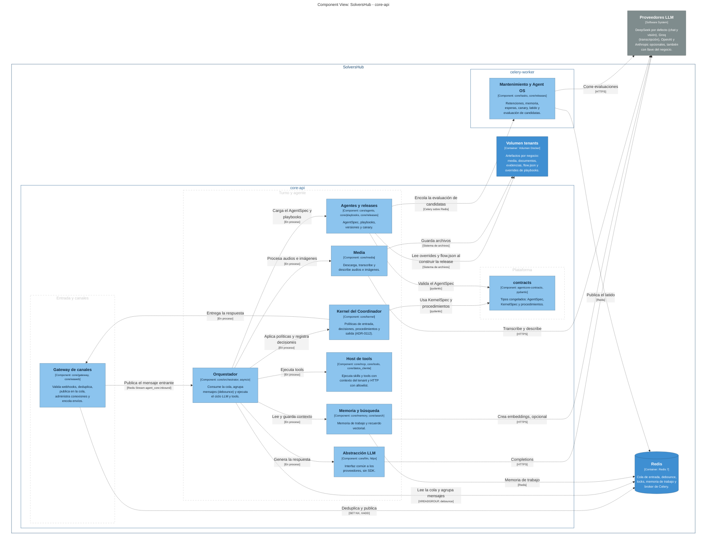
<!-- /c4:core-api-turno -->

#### Plataforma

<!-- c4:core-api-plataforma -->
```mermaid
graph LR

  subgraph diagram ["Component View: SolversHub - core-api"]
    direction LR
    style diagram fill:#ffffff,stroke:#ffffff

    10["<div style='font-weight: bold'>Wompi</div><div style='font-size: 70%; margin-top: 0px'>[Software System]</div><div style='font-size: 80%; margin-top:10px'>Cobro de la plataforma y<br />links de pago de cada<br />negocio.</div>"]
    style 10 fill:#7f8c8d,stroke:#586262,color:#ffffff
    11["<div style='font-weight: bold'>Proveedores LLM</div><div style='font-size: 70%; margin-top: 0px'>[Software System]</div><div style='font-size: 80%; margin-top:10px'>DeepSeek por defecto (chat y<br />visión), Groq<br />(transcripción), OpenAI y<br />Anthropic opcionales, también<br />con llave del negocio.</div>"]
    style 11 fill:#7f8c8d,stroke:#586262,color:#ffffff
    15["<div style='font-weight: bold'>Correo</div><div style='font-size: 70%; margin-top: 0px'>[Software System]</div><div style='font-size: 80%; margin-top:10px'>SMTP para el backend y Resend<br />para la landing.</div>"]
    style 15 fill:#7f8c8d,stroke:#586262,color:#ffffff
    18["<div style='font-weight: bold'>Servicios de observabilidad</div><div style='font-size: 70%; margin-top: 0px'>[Software System]</div><div style='font-size: 80%; margin-top:10px'>Grafana Cloud (Loki, Mimir,<br />Tempo, Synthetic), Sentry y<br />alertas en Slack.</div>"]
    style 18 fill:#7f8c8d,stroke:#586262,color:#ffffff

    subgraph 20 ["SolversHub"]
      style 20 fill:#ffffff,stroke:#204c72,color:#204c72

      subgraph 24 ["core-api"]
        style 24 fill:#ffffff,stroke:#2c6493,color:#2c6493

        subgraph group1 ["Entrada y canales"]
          style group1 fill:#ffffff,stroke:#cccccc,color:#cccccc,stroke-dasharray:5

          26["<div style='font-weight: bold'>API /api/v1</div><div style='font-size: 70%; margin-top: 0px'>[Component: core/api, FastAPI]</div><div style='font-size: 80%; margin-top:10px'>Unos 60 routers JSON para<br />panel y app. Publica el chat<br />web.</div>"]
          style 26 fill:#8cc4ee,stroke:#6289a6,color:#10253a
          27["<div style='font-weight: bold'>Panel clásico</div><div style='font-size: 70%; margin-top: 0px'>[Component: core/admin, Jinja]</div><div style='font-size: 80%; margin-top:10px'>Panel SSR /admin, que se<br />retira por secciones<br />(ADR-0076).</div>"]
          style 27 fill:#8cc4ee,stroke:#6289a6,color:#10253a
        end

        subgraph group2 ["Plataforma"]
          style group2 fill:#ffffff,stroke:#cccccc,color:#cccccc,stroke-dasharray:5

          35["<div style='font-weight: bold'>Plugin manager</div><div style='font-size: 70%; margin-top: 0px'>[Component: core/plugin_manager.py]</div><div style='font-size: 80%; margin-top:10px'>Descubre packs por entry<br />points y administra su ciclo<br />de vida por tenant.</div>"]
          style 35 fill:#8cc4ee,stroke:#6289a6,color:#10253a
          36["<div style='font-weight: bold'>Facturación</div><div style='font-size: 70%; margin-top: 0px'>[Component: core/billing]</div><div style='font-size: 80%; margin-top:10px'>Planes, cuotas y cobro de la<br />plataforma.</div>"]
          style 36 fill:#8cc4ee,stroke:#6289a6,color:#10253a
          37["<div style='font-weight: bold'>Acceso y seguridad</div><div style='font-size: 70%; margin-top: 0px'>[Component: core/access, core/security]</div><div style='font-size: 80%; margin-top:10px'>Sesiones, dispositivos, rate<br />limit y bloqueo.</div>"]
          style 37 fill:#8cc4ee,stroke:#6289a6,color:#10253a
          38["<div style='font-weight: bold'>Eventos y avisos</div><div style='font-size: 70%; margin-top: 0px'>[Component: core/events, core/notifications]</div><div style='font-size: 80%; margin-top:10px'>Outbox de eventos de dominio<br />y centro de notificaciones.</div>"]
          style 38 fill:#8cc4ee,stroke:#6289a6,color:#10253a
          39["<div style='font-weight: bold'>Datos y operación</div><div style='font-size: 70%; margin-top: 0px'>[Component: core/db, core/provisioning, core/qa, core/observability]</div><div style='font-size: 80%; margin-top:10px'>RLS por tenant, alta de<br />negocios, QA y<br />observabilidad.</div>"]
          style 39 fill:#8cc4ee,stroke:#6289a6,color:#10253a
          40["<div style='font-weight: bold'>Registros de capacidades</div><div style='font-size: 70%; margin-top: 0px'>[Component: core/payments, core/subscriptions]</div><div style='font-size: 80%; margin-top:10px'>Los packs publican y consumen<br />capacidades sin importarse<br />entre sí.</div>"]
          style 40 fill:#8cc4ee,stroke:#6289a6,color:#10253a
          41["<div style='font-weight: bold'>Almacenamiento</div><div style='font-size: 70%; margin-top: 0px'>[Component: core/almacenamiento]</div><div style='font-size: 80%; margin-top:10px'>Controlador único para<br />guardar y abrir archivos del<br />negocio (ADR-0085).</div>"]
          style 41 fill:#8cc4ee,stroke:#6289a6,color:#10253a
        end

        subgraph group3 ["Turno y agente"]
          style group3 fill:#ffffff,stroke:#cccccc,color:#cccccc,stroke-dasharray:5

          32["<div style='font-weight: bold'>Host de tools</div><div style='font-size: 70%; margin-top: 0px'>[Component: core/mcp, core/tools, core/datos_cliente]</div><div style='font-size: 80%; margin-top:10px'>Ejecuta skills y tools con<br />contexto del tenant y HTTP<br />con allowlist.</div>"]
          style 32 fill:#8cc4ee,stroke:#6289a6,color:#10253a
        end

      end

      subgraph 50 ["celery-worker"]
        style 50 fill:#ffffff,stroke:#2c6493,color:#2c6493

        55["<div style='font-weight: bold'>Push</div><div style='font-size: 70%; margin-top: 0px'>[Component: core/tasks/push_tasks.py]</div><div style='font-size: 80%; margin-top:10px'>Notificaciones a la app<br />móvil.</div>"]
        style 55 fill:#8cc4ee,stroke:#6289a6,color:#10253a
      end

      63["<div style='font-weight: bold'>Volumen tenants</div><div style='font-size: 70%; margin-top: 0px'>[Container: Volumen Docker]</div><div style='font-size: 80%; margin-top:10px'>Artefactos por negocio:<br />media, documentos,<br />evidencias, flow.json y<br />overrides de playbooks.</div>"]
      style 63 fill:#3f8fd2,stroke:#2c6493,color:#ffffff
    end

    26-. "<div>Consulta planes y cuotas</div><div style='font-size: 70%'>[En proceso]</div>" .->36
    26-. "<div>Autentica y limita</div><div style='font-size: 70%'>[En proceso]</div>" .->37
    26-. "<div>Da de alta y consulta datos</div><div style='font-size: 70%'>[En proceso]</div>" .->39
    27-. "<div>Lee y escribe datos</div><div style='font-size: 70%'>[En proceso]</div>" .->39
    35-. "<div>Registra skills, tools y<br />guardrails</div><div style='font-size: 70%'>[En proceso]</div>" .->32
    41-. "<div>Guarda y abre archivos</div><div style='font-size: 70%'>[Sistema de archivos]</div>" .->63
    36-. "<div>Cobra la suscripción</div><div style='font-size: 70%'>[HTTPS]</div>" .->10
    38-. "<div>Encola notificaciones</div><div style='font-size: 70%'>[Celery sobre Redis]</div>" .->55
    39-. "<div>Envía accesos</div><div style='font-size: 70%'>[SMTP]</div>" .->15
    39-. "<div>Genera datos de prueba</div><div style='font-size: 70%'>[HTTPS]</div>" .->11
    39-. "<div>Envía errores y alertas</div><div style='font-size: 70%'>[Sentry, Slack]</div>" .->18

  end
```
<!-- /c4:core-api-plataforma -->

### celery-worker

<!-- c4:worker -->
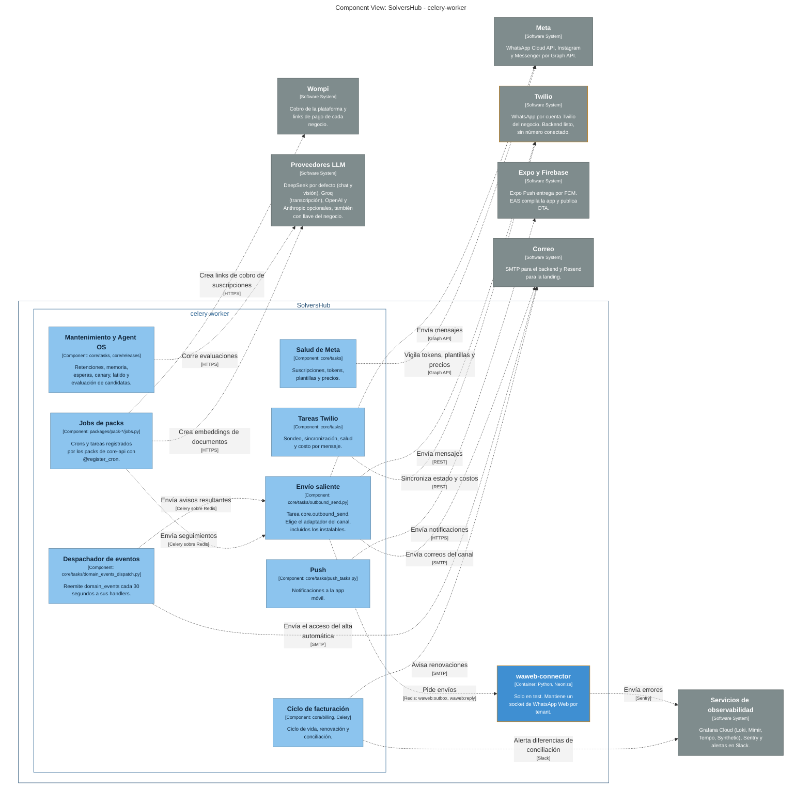
<!-- /c4:worker -->

### Packs

Corren dentro de `core-api` y de `celery-worker`. En C4 un componente pertenece a un solo
contenedor, así que se modelan en `core-api`, y el worker los representa con «Jobs de packs».

<!-- c4:packs -->
```mermaid
graph LR

  subgraph diagram ["Component View: SolversHub - core-api"]
    direction LR
    style diagram fill:#ffffff,stroke:#ffffff

    10["<div style='font-weight: bold'>Wompi</div><div style='font-size: 70%; margin-top: 0px'>[Software System]</div><div style='font-size: 80%; margin-top:10px'>Cobro de la plataforma y<br />links de pago de cada<br />negocio.</div>"]
    style 10 fill:#7f8c8d,stroke:#586262,color:#ffffff
    13["<div style='font-weight: bold'>Google Calendar</div><div style='font-size: 70%; margin-top: 0px'>[Software System]</div><div style='font-size: 80%; margin-top:10px'>Agenda externa de cada<br />negocio por OAuth2.</div>"]
    style 13 fill:#7f8c8d,stroke:#586262,color:#ffffff
    16["<div style='font-weight: bold'>Cloudflare</div><div style='font-size: 70%; margin-top: 0px'>[Software System]</div><div style='font-size: 80%; margin-top:10px'>DNS, Tunnel, Access y<br />Turnstile.</div>"]
    style 16 fill:#7f8c8d,stroke:#586262,color:#ffffff
    8["<div style='font-weight: bold'>Twilio</div><div style='font-size: 70%; margin-top: 0px'>[Software System]</div><div style='font-size: 80%; margin-top:10px'>WhatsApp por cuenta Twilio<br />del negocio. Backend listo,<br />sin número conectado.</div>"]
    style 8 fill:#7f8c8d,stroke:#c77700,color:#ffffff

    subgraph 20 ["SolversHub"]
      style 20 fill:#ffffff,stroke:#204c72,color:#204c72

      subgraph 24 ["core-api"]
        style 24 fill:#ffffff,stroke:#2c6493,color:#2c6493

        subgraph group1 ["Entrada y canales"]
          style group1 fill:#ffffff,stroke:#cccccc,color:#cccccc,stroke-dasharray:5

          25["<div style='font-weight: bold'>Gateway de canales</div><div style='font-size: 70%; margin-top: 0px'>[Component: core/gateway, core/waweb]</div><div style='font-size: 80%; margin-top:10px'>Valida webhooks, deduplica,<br />publica en la cola,<br />administra conexiones y<br />encola envíos.</div>"]
          style 25 fill:#8cc4ee,stroke:#6289a6,color:#10253a
        end

        subgraph group2 ["Packs"]
          style group2 fill:#ffffff,stroke:#cccccc,color:#cccccc,stroke-dasharray:5

          44["<div style='font-weight: bold'>pack-cobranza</div><div style='font-size: 70%; margin-top: 0px'>[Component: Python, 18 migraciones]</div><div style='font-size: 80%; margin-top:10px'>Cartera, préstamos y rutas.<br />API de la app en<br />/api/pack/pack_cobranza.</div>"]
          style 44 fill:#d9b36c,stroke:#977d4b,color:#2b2110
          45["<div style='font-weight: bold'>pack-commerce</div><div style='font-size: 70%; margin-top: 0px'>[Component: Python, 19 migraciones]</div><div style='font-size: 80%; margin-top:10px'>Leads, catálogo y pedidos.<br />Recibe leads en<br />/api/pack/pack_commerce.</div>"]
          style 45 fill:#d9b36c,stroke:#977d4b,color:#2b2110
          46["<div style='font-weight: bold'>pack-subscriptions</div><div style='font-size: 70%; margin-top: 0px'>[Component: Python, 13 migraciones]</div><div style='font-size: 80%; margin-top:10px'>Planes e inscripción de<br />clientes finales.</div>"]
          style 46 fill:#d9b36c,stroke:#977d4b,color:#2b2110
          47["<div style='font-weight: bold'>pack-calendar</div><div style='font-size: 70%; margin-top: 0px'>[Component: Python, 6 migraciones]</div><div style='font-size: 80%; margin-top:10px'>Citas con agenda interna o<br />Google.</div>"]
          style 47 fill:#d9b36c,stroke:#977d4b,color:#2b2110
          48["<div style='font-weight: bold'>pack-payments</div><div style='font-size: 70%; margin-top: 0px'>[Component: Python, 3 migraciones]</div><div style='font-size: 80%; margin-top:10px'>Links de pago. Se registra en<br />core.payments.payment_registry.</div>"]
          style 48 fill:#d9b36c,stroke:#977d4b,color:#2b2110
          49["<div style='font-weight: bold'>pack-knowledge</div><div style='font-size: 70%; margin-top: 0px'>[Component: Python, 2 migraciones, pgvector]</div><div style='font-size: 80%; margin-top:10px'>Documentos por agente con<br />búsqueda vectorial.</div>"]
          style 49 fill:#d9b36c,stroke:#977d4b,color:#2b2110
        end

        subgraph group3 ["Plataforma"]
          style group3 fill:#ffffff,stroke:#cccccc,color:#cccccc,stroke-dasharray:5

          35["<div style='font-weight: bold'>Plugin manager</div><div style='font-size: 70%; margin-top: 0px'>[Component: core/plugin_manager.py]</div><div style='font-size: 80%; margin-top:10px'>Descubre packs por entry<br />points y administra su ciclo<br />de vida por tenant.</div>"]
          style 35 fill:#8cc4ee,stroke:#6289a6,color:#10253a
          40["<div style='font-weight: bold'>Registros de capacidades</div><div style='font-size: 70%; margin-top: 0px'>[Component: core/payments, core/subscriptions]</div><div style='font-size: 80%; margin-top:10px'>Los packs publican y consumen<br />capacidades sin importarse<br />entre sí.</div>"]
          style 40 fill:#8cc4ee,stroke:#6289a6,color:#10253a
          41["<div style='font-weight: bold'>Almacenamiento</div><div style='font-size: 70%; margin-top: 0px'>[Component: core/almacenamiento]</div><div style='font-size: 80%; margin-top:10px'>Controlador único para<br />guardar y abrir archivos del<br />negocio (ADR-0085).</div>"]
          style 41 fill:#8cc4ee,stroke:#6289a6,color:#10253a
          42["<div style='font-weight: bold'>contracts</div><div style='font-size: 70%; margin-top: 0px'>[Component: agentcore-contracts, pydantic]</div><div style='font-size: 80%; margin-top:10px'>Tipos congelados: AgentSpec,<br />KernelSpec y procedimientos.</div>"]
          style 42 fill:#8cc4ee,stroke:#6289a6,color:#10253a
          43["<div style='font-weight: bold'>Canales instalables</div><div style='font-size: 70%; margin-top: 0px'>[Component: packages/channel-*]</div><div style='font-size: 80%; margin-top:10px'>Adaptadores twilio, waweb y<br />web por el entry point<br />agent_core.channels. También<br />los usa el worker.</div>"]
          style 43 fill:#8cc4ee,stroke:#6289a6,color:#10253a
        end

        subgraph group4 ["Turno y agente"]
          style group4 fill:#ffffff,stroke:#cccccc,color:#cccccc,stroke-dasharray:5

          29["<div style='font-weight: bold'>Kernel del Coordinador</div><div style='font-size: 70%; margin-top: 0px'>[Component: core/kernel]</div><div style='font-size: 80%; margin-top:10px'>Políticas de entrada,<br />decisiones, procedimientos y<br />salida (ADR-0112).</div>"]
          style 29 fill:#8cc4ee,stroke:#6289a6,color:#10253a
          30["<div style='font-weight: bold'>Agentes y releases</div><div style='font-size: 70%; margin-top: 0px'>[Component: core/agents, core/playbooks, core/releases]</div><div style='font-size: 80%; margin-top:10px'>AgentSpec, playbooks,<br />versiones y canary.</div>"]
          style 30 fill:#8cc4ee,stroke:#6289a6,color:#10253a
        end

      end

      21["<div style='font-weight: bold'>landing</div><div style='font-size: 70%; margin-top: 0px'>[Container: Next.js 16]</div><div style='font-size: 80%; margin-top:10px'>Sitio público, formularios de<br />leads y chat web.</div>"]
      style 21 fill:#3f8fd2,stroke:#2c6493,color:#ffffff
      23["<div style='font-weight: bold'>App móvil</div><div style='font-size: 70%; margin-top: 0px'>[Container: Expo, React Native, SQLCipher]</div><div style='font-size: 80%; margin-top:10px'>Cobranza en campo para<br />gestores y seguimiento del<br />negocio para dueños y<br />administradores, con datos<br />locales cifrados.</div>"]
      style 23 fill:#3f8fd2,stroke:#2c6493,color:#ffffff
    end

    21-. "<div>Muestra el widget Turnstile<br />en el navegador</div><div style='font-size: 70%'>[HTTPS]</div>" .->16
    8-. "<div>Entrega mensajes</div><div style='font-size: 70%'>[Webhook HTTPS]</div>" .->25
    10-. "<div>Notifica pagos de la<br />plataforma</div><div style='font-size: 70%'>[Webhook HTTPS]</div>" .->25
    10-. "<div>Notifica pagos de los<br />negocios</div><div style='font-size: 70%'>[Webhook HTTPS]</div>" .->48
    23-. "<div>Usa la API de campo</div><div style='font-size: 70%'>[HTTPS]</div>" .->44
    21-. "<div>Envía leads</div><div style='font-size: 70%'>[HTTP]</div>" .->45
    25-. "<div>Administra conexiones</div><div style='font-size: 70%'>[REST]</div>" .->8
    25-. "<div>Resuelve el adaptador del<br />canal</div><div style='font-size: 70%'>[entry points]</div>" .->43
    25-. "<div>Reenvía el evento si la<br />cuenta es compartida</div><div style='font-size: 70%'>[En proceso]</div>" .->48
    43-. "<div>Usa REST y Content API</div><div style='font-size: 70%'>[REST]</div>" .->8
    29-. "<div>Entrega la respuesta</div><div style='font-size: 70%'>[En proceso]</div>" .->25
    29-. "<div>Usa KernelSpec y<br />procedimientos</div><div style='font-size: 70%'>[pydantic]</div>" .->42
    30-. "<div>Valida el AgentSpec</div><div style='font-size: 70%'>[pydantic]</div>" .->42
    35-. "<div>Activa por tenant</div><div style='font-size: 70%'>[entry points]</div>" .->44
    35-. "<div>Activa por tenant</div><div style='font-size: 70%'>[entry points]</div>" .->45
    35-. "<div>Activa por tenant</div><div style='font-size: 70%'>[entry points]</div>" .->46
    35-. "<div>Activa por tenant</div><div style='font-size: 70%'>[entry points]</div>" .->47
    35-. "<div>Activa por tenant</div><div style='font-size: 70%'>[entry points]</div>" .->48
    35-. "<div>Activa por tenant</div><div style='font-size: 70%'>[entry points]</div>" .->49
    49-. "<div>Usa sus tipos</div><div style='font-size: 70%'>[pydantic]</div>" .->42
    45-. "<div>Guarda fotos</div><div style='font-size: 70%'>[En proceso]</div>" .->41
    49-. "<div>Guarda documentos</div><div style='font-size: 70%'>[En proceso]</div>" .->41
    45-. "<div>Valida Turnstile en leads</div><div style='font-size: 70%'>[HTTPS]</div>" .->16
    47-. "<div>Sincroniza citas</div><div style='font-size: 70%'>[OAuth2, HTTPS]</div>" .->13
    48-. "<div>Crea links de pago</div><div style='font-size: 70%'>[HTTPS]</div>" .->10
    48-. "<div>Registra su capacidad de pago</div><div style='font-size: 70%'>[En proceso]</div>" .->40
    46-. "<div>Registra su capacidad y pide<br />links</div><div style='font-size: 70%'>[En proceso]</div>" .->40
    44-. "<div>Pide links de pago</div><div style='font-size: 70%'>[En proceso]</div>" .->40
    45-. "<div>Pide links de pago</div><div style='font-size: 70%'>[En proceso]</div>" .->40

  end
```
<!-- /c4:packs -->

## Despliegue

### Producción heredada

Sigue documentada como vigente en `docs/despliegue-coolify.md`. El salto D-59 (base nueva en la
misma máquina, sin Meta) la cambia cuando se ejecute.

<!-- c4:despliegue-heredada -->
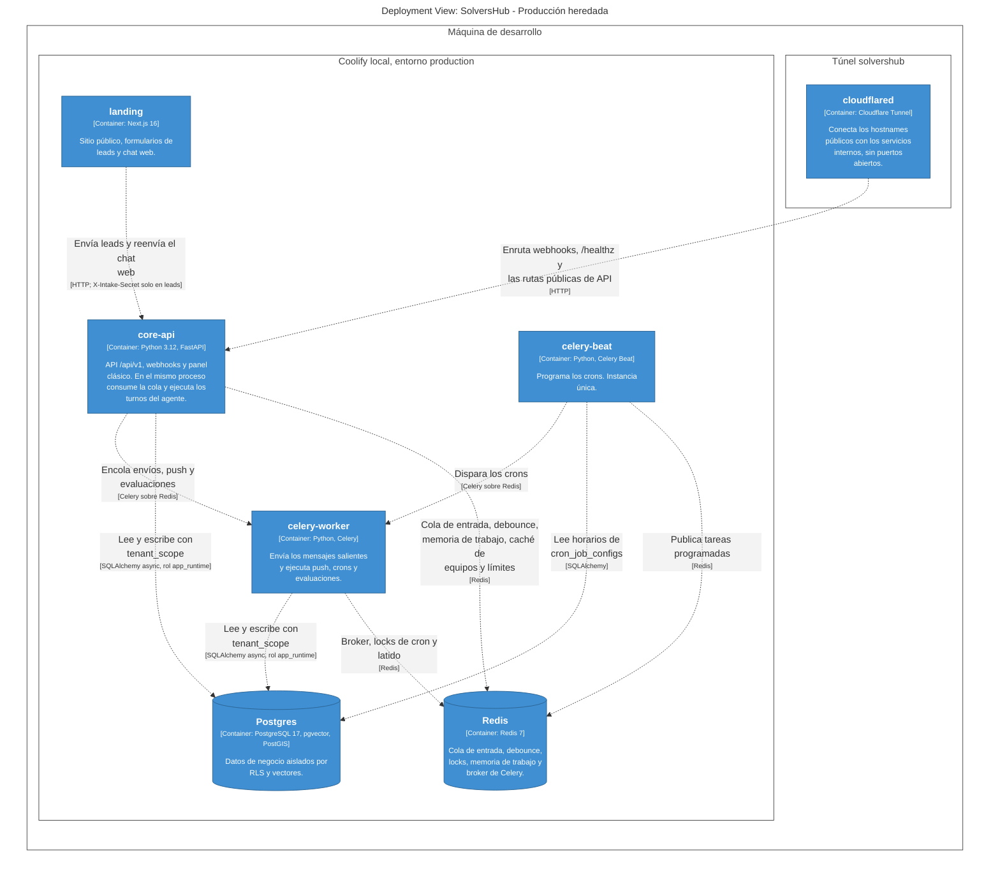
<!-- /c4:despliegue-heredada -->

### Test

<!-- c4:despliegue-test -->
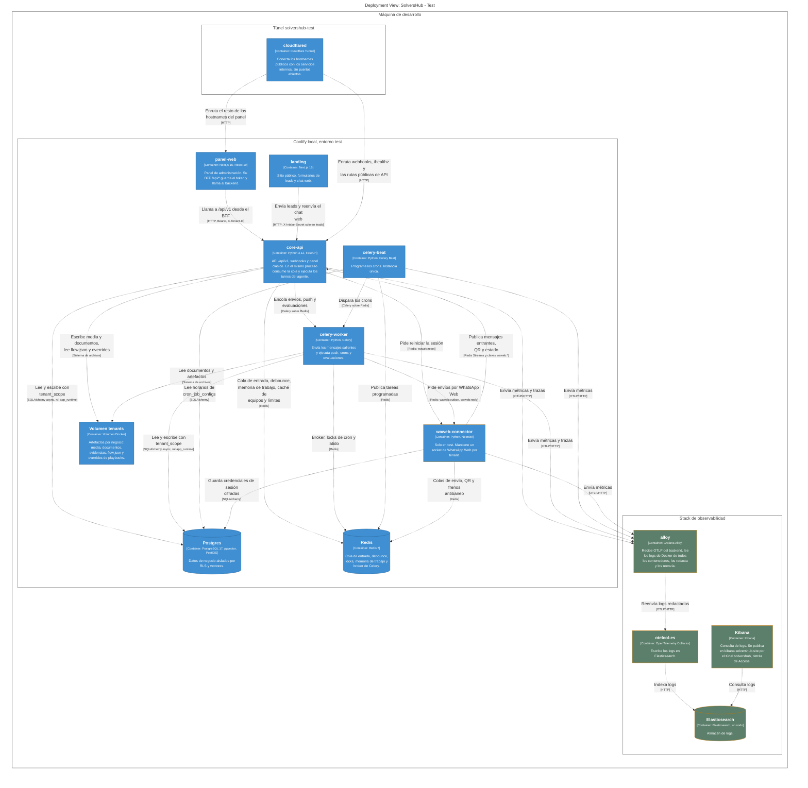
<!-- /c4:despliegue-test -->

### Producción objetivo

**No es el estado actual.** Son dos VPS pendientes de contratar (HU-ARCH-01).

<!-- c4:despliegue-objetivo -->
```mermaid
graph LR

  subgraph diagram ["Deployment View: Producción objetivo"]
    direction LR
    style diagram fill:#ffffff,stroke:#ffffff

    subgraph 362 ["prod-app"]
      style 362 fill:#ffffff,stroke:#444444,color:#444444

      subgraph 363 ["Coolify"]
        style 363 fill:#ffffff,stroke:#444444,color:#444444

        364["<div style='font-weight: bold'>core-api</div><div style='font-size: 70%; margin-top: 0px'>[Container: Python 3.12, FastAPI]</div><div style='font-size: 80%; margin-top:10px'>API /api/v1, webhooks y panel<br />clásico. En el mismo proceso<br />consume la cola y ejecuta los<br />turnos del agente.</div>"]
        style 364 fill:#3f8fd2,stroke:#2c6493,color:#ffffff
        365["<div style='font-weight: bold'>panel-web</div><div style='font-size: 70%; margin-top: 0px'>[Container: Next.js 16, React 19]</div><div style='font-size: 80%; margin-top:10px'>Panel de administración. Su<br />BFF /api/* guarda el token y<br />llama al backend.</div>"]
        style 365 fill:#3f8fd2,stroke:#2c6493,color:#ffffff
        367["<div style='font-weight: bold'>landing</div><div style='font-size: 70%; margin-top: 0px'>[Container: Next.js 16]</div><div style='font-size: 80%; margin-top:10px'>Sitio público, formularios de<br />leads y chat web.</div>"]
        style 367 fill:#3f8fd2,stroke:#2c6493,color:#ffffff
        369["<div style='font-weight: bold'>celery-worker</div><div style='font-size: 70%; margin-top: 0px'>[Container: Python, Celery]</div><div style='font-size: 80%; margin-top:10px'>Envía los mensajes salientes<br />y ejecuta push, crons y<br />evaluaciones.</div>"]
        style 369 fill:#3f8fd2,stroke:#2c6493,color:#ffffff
        371["<div style='font-weight: bold'>celery-beat</div><div style='font-size: 70%; margin-top: 0px'>[Container: Python, Celery Beat]</div><div style='font-size: 80%; margin-top:10px'>Programa los crons. Instancia<br />única.</div>"]
        style 371 fill:#3f8fd2,stroke:#2c6493,color:#ffffff
        373["<div style='font-weight: bold'>Volumen tenants</div><div style='font-size: 70%; margin-top: 0px'>[Container: Volumen Docker]</div><div style='font-size: 80%; margin-top:10px'>Artefactos por negocio:<br />media, documentos,<br />evidencias, flow.json y<br />overrides de playbooks.</div>"]
        style 373 fill:#3f8fd2,stroke:#2c6493,color:#ffffff
      end

      subgraph 376 ["Túnel solvershub-prod"]
        style 376 fill:#ffffff,stroke:#444444,color:#444444

        377["<div style='font-weight: bold'>cloudflared</div><div style='font-size: 70%; margin-top: 0px'>[Container: Cloudflare Tunnel]</div><div style='font-size: 80%; margin-top:10px'>Conecta los hostnames<br />públicos con los servicios<br />internos, sin puertos<br />abiertos.</div>"]
        style 377 fill:#3f8fd2,stroke:#2c6493,color:#ffffff
      end

    end

    subgraph 380 ["prod-data"]
      style 380 fill:#ffffff,stroke:#444444,color:#444444

      381[("<div style='font-weight: bold'>Postgres</div><div style='font-size: 70%; margin-top: 0px'>[Container: PostgreSQL 17, pgvector, PostGIS]</div><div style='font-size: 80%; margin-top:10px'>Datos de negocio aislados por<br />RLS y vectores.</div>")]
      style 381 fill:#3f8fd2,stroke:#2c6493,color:#ffffff
      385[("<div style='font-weight: bold'>Redis</div><div style='font-size: 70%; margin-top: 0px'>[Container: Redis 7]</div><div style='font-size: 80%; margin-top:10px'>Cola de entrada, debounce,<br />locks, memoria de trabajo y<br />broker de Celery.</div>")]
      style 385 fill:#3f8fd2,stroke:#2c6493,color:#ffffff
    end

    subgraph 389 ["Proveedor S3"]
      style 389 fill:#ffffff,stroke:#444444,color:#444444

      390["<div style='font-weight: bold'>Almacenamiento S3</div><div style='font-size: 70%; margin-top: 0px'>[Software System]</div><div style='font-size: 80%; margin-top:10px'>Respaldos fuera del proveedor<br />principal. Solo en el diseño<br />objetivo.</div>"]
      style 390 fill:#7f8c8d,stroke:#586262,color:#ffffff
    end

    365-. "<div>Llama a /api/v1 desde el BFF</div><div style='font-size: 70%'>[HTTP, Bearer, X-Tenant-Id]</div>" .->364
    367-. "<div>Envía leads y reenvía el chat<br />web</div><div style='font-size: 70%'>[HTTP; X-Intake-Secret solo en leads]</div>" .->364
    364-. "<div>Encola envíos, push y<br />evaluaciones</div><div style='font-size: 70%'>[Celery sobre Redis]</div>" .->369
    371-. "<div>Dispara los crons</div><div style='font-size: 70%'>[Celery sobre Redis]</div>" .->369
    364-. "<div>Escribe media y documentos,<br />lee flow.json y overrides</div><div style='font-size: 70%'>[Sistema de archivos]</div>" .->373
    369-. "<div>Lee documentos y artefactos</div><div style='font-size: 70%'>[Sistema de archivos]</div>" .->373
    377-. "<div>Enruta webhooks, /healthz y<br />las rutas públicas de API</div><div style='font-size: 70%'>[HTTP]</div>" .->364
    377-. "<div>Enruta el resto de los<br />hostnames del panel</div><div style='font-size: 70%'>[HTTP]</div>" .->365
    364-. "<div>Lee y escribe con<br />tenant_scope</div><div style='font-size: 70%'>[SQLAlchemy async, rol app_runtime]</div>" .->381
    369-. "<div>Lee y escribe con<br />tenant_scope</div><div style='font-size: 70%'>[SQLAlchemy async, rol app_runtime]</div>" .->381
    371-. "<div>Lee horarios de<br />cron_job_configs</div><div style='font-size: 70%'>[SQLAlchemy]</div>" .->381
    364-. "<div>Cola de entrada, debounce,<br />memoria de trabajo, caché de<br />equipos y límites</div><div style='font-size: 70%'>[Redis]</div>" .->385
    369-. "<div>Broker, locks de cron y<br />latido</div><div style='font-size: 70%'>[Redis]</div>" .->385
    371-. "<div>Publica tareas programadas</div><div style='font-size: 70%'>[Redis]</div>" .->385
    373-. "<div>Envía copia diaria versionada</div><div style='font-size: 70%'>[S3]</div>" .->390
    381-. "<div>Envía respaldos</div><div style='font-size: 70%'>[S3]</div>" .->390

  end
```
<!-- /c4:despliegue-objetivo -->

## Preguntas abiertas

- **Ruta de la app en producción.** `solvershub-apk/eas.json:49` apunta a
  `app.solvershub.site/api/pack/pack_cobranza`, y `docs/despliegue-coolify.md:94-96` dice que esa
  ruta no es pública en producción todavía.
- **Publicación de la landing.** Tiene contenedores en test y en producción heredada, pero el
  repo no documenta qué túnel publica el dominio raíz y `www`.

## Invariantes visibles en el diagrama

- **Aislamiento**: cada punto de entrada entra por `tenant_scope` → `set_config`
  (`app.tenant_id`, transacción) → RLS. El runtime conecta como `app_runtime` (no
  dueño); migraciones/bootstrap como el dueño (`MIGRATIONS_DATABASE_URL`).
- **Enablement por tenant**: `spec.packs` (ADR-0019) filtra skills/guardrails/
  eventos/crons y el consentimiento de tools.
- **Cero prompts en código**: prompts en `AgentSpec` (BD) y playbooks del pack
  (allowlist). Copy en config por tenant.
- **Contratos congelados**: `packages/contracts` inmutable (ADR-0011).
- **Packs independientes**: ningún pack importa de otro (`.importlinter`).
- **Billing de plataforma**: el cobro usa credenciales propias de la plataforma, nunca
  las del tenant (ADR-0046).
