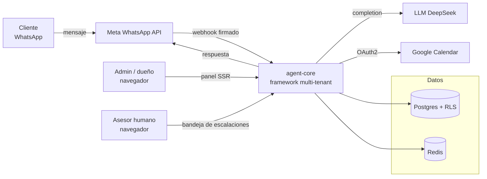
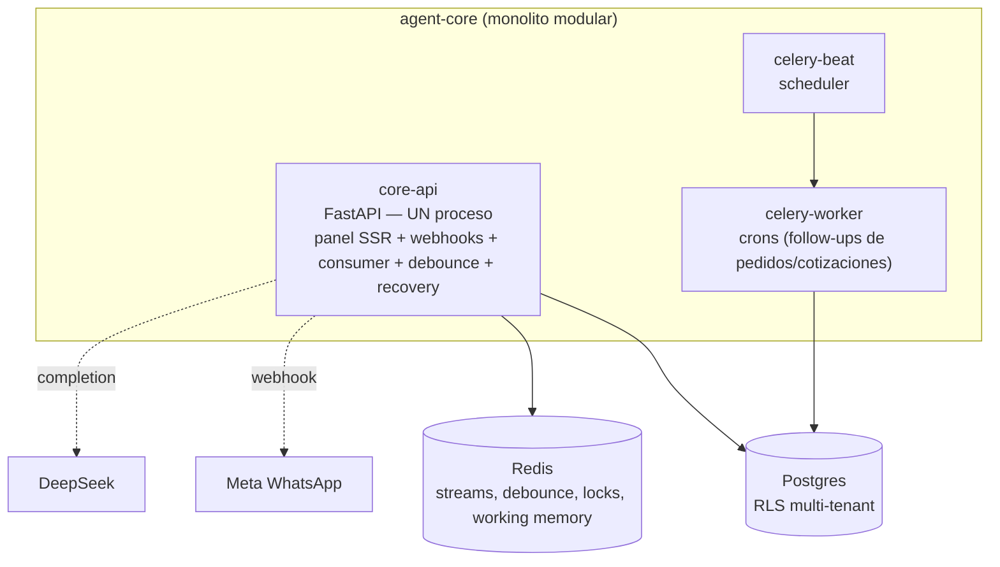
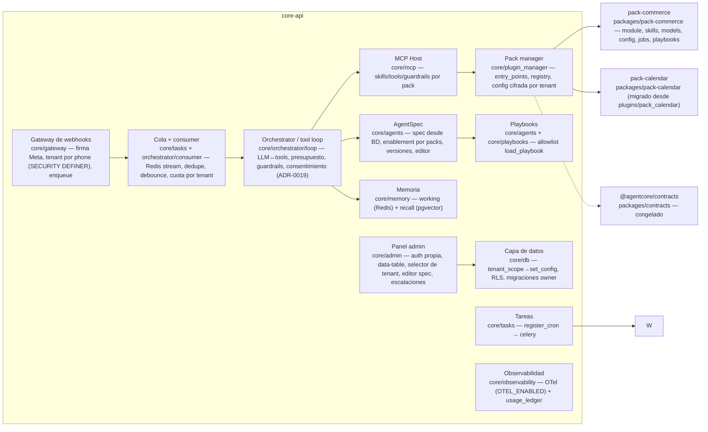

# Diagrama C4 de agent-core — estado al día de hoy

Modelo C4 (Simon Brown) en Mermaid (renderizable en GitHub/VS Code). Refleja el
estado real al cierre del Sprint 4, Fase C: monolito modular en `core/`, packs en
`packages/`, multi-tenant con RLS.

## Nivel 1 — Contexto

## Nivel 2 — Contenedores (deployment)

> Nota estructural: `apps/gateway`, `apps/agentos`, `apps/worker` y los packages
> `core-crm`, `core-runtime`, `channel-whatsapp`, `pack-calendar` (antes de la
> migración) son stubs vacíos del plan original. El código real vive en `core/`
> (monolito modular) y solo `contracts` y los `pack-*` son packages reales.

## Nivel 3 — Componentes (`core-api`)

## Invariantes visibles en el diagrama

- **Aislamiento**: cada punto de entrada entra por `tenant_scope` → `set_config`
  (`app.tenant_id`, transacción) → RLS. El runtime conecta como `app_runtime` (no
  dueño); migraciones/bootstrap como el dueño (`MIGRATIONS_DATABASE_URL`).
- **Enablement por tenant**: `spec.packs` (ADR-0019) filtra skills/guardrails/
  eventos/crons y el consentimiento de tools.
- **Cero prompts en código**: prompts en `AgentSpec` (BD) y playbooks del pack
  (allowlist). Copy en config por tenant.
- **Contratos congelados**: `packages/contracts` inmutable (ADR-0011).

## Mejoras identificadas (detalle en docs/BACKLOG.md)

1. Estructura declarada (CLAUDE.md) ≠ realidad → documentada aquí (baja).
2. `plugins/` legacy migrado a `packages/pack-calendar` (hecho).
3. Topología: panel y gateway+consumer en un solo proceso → ADR-0021 (decisión).
4. Dos subsistemas de cola (consumer propio + Celery) → ver ADR-0021.
5. Observabilidad gated por `OTEL_ENABLED` → activar exporter OTLP en producción.
6. Consentimiento de scopes fail-open transitorio → migrar bindings y cerrar.